# ERD — existing core and proposed extensions

Solid entities below are canonical existing source structures. Names beginning `proposed_` are logical future extensions, not deployed tables. The diagram is intentionally domain-level; no production schema is claimed.

```mermaid
erDiagram
  app_user ||--o{ organization_member : joins
  organization ||--o{ organization_member : has
  app_user ||--o{ consent_event : consents
  policy_document ||--o{ consent_event : versions
  app_user ||--o{ look : owns
  look ||--o{ look_revision : versions
  app_user ||--|| credit_account : has
  credit_account ||--o{ credit_journal : journals
  credit_journal ||--o{ credit_posting : balances
  organization ||--o{ workspace_role : authorizes
  organization ||--o{ catalog_listing : owns
  catalog_listing ||--o{ catalog_revision : versions
  catalog_revision ||--o{ catalog_approval : approves
  app_user ||--o{ proposed_style_passport : owns
  proposed_style_passport ||--o{ proposed_analysis_session : records
  proposed_analysis_session ||--o{ proposed_finding_revision : corrects
  proposed_analysis_session ||--o{ proposed_private_media : references
  look_revision ||--o{ proposed_transformation_variant : renders
  app_user ||--o{ proposed_wardrobe_item : owns
  app_user ||--o{ proposed_trip : plans
  proposed_trip ||--o{ proposed_weather_snapshot : cites
  proposed_trip ||--o{ proposed_packing_item : contains
  catalog_listing ||--o{ proposed_variant : extends
  proposed_variant ||--o{ proposed_stock_movement : tracks
  app_user ||--o{ proposed_order : buys
  proposed_order ||--o{ proposed_merchant_suborder : partitions
  organization ||--o{ proposed_merchant_suborder : fulfills
  proposed_merchant_suborder ||--o{ proposed_order_item : snapshots
  proposed_order_item ||--o{ proposed_financial_allocation : allocates
  proposed_financial_journal ||--o{ proposed_financial_posting : balances
  proposed_financial_allocation }o--|| proposed_financial_journal : records
  organization ||--o{ proposed_professional_service : provides
  proposed_professional_service ||--o{ proposed_booking : schedules
  app_user ||--o{ proposed_booking : books
  organization ||--o{ proposed_campaign : sponsors
  proposed_campaign ||--o{ proposed_placement : serves
  app_user ||--o{ proposed_attribution : consents
  proposed_attribution ||--o{ proposed_affiliate_earning : validates
  outbox_event ||--o{ proposed_delivery_attempt : delivers
```

Existing FK/details are in canonical migration files. A completed detailed ERD requires full remote SQL introspection and reviewed per-batch migrations; it must distinguish current tables from these proposed relationships. No synthetic FK is asserted to exist remotely.
