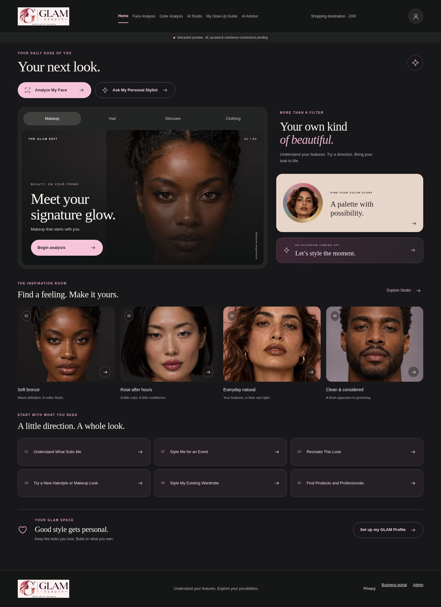
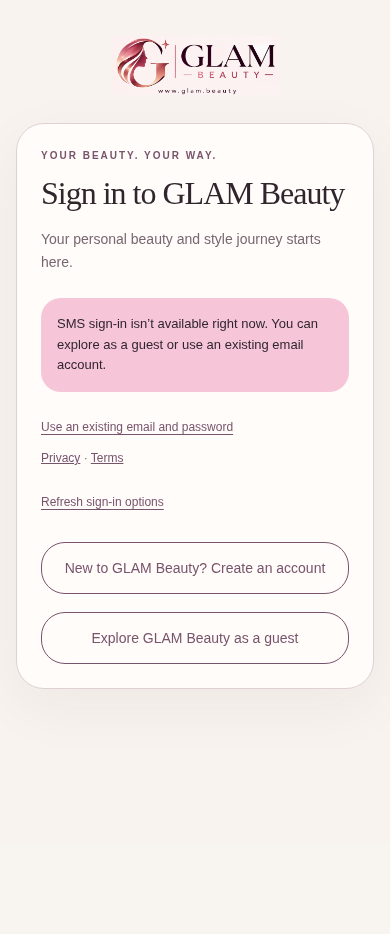

# Actual browser evidence

These screenshots and recordings show the current local Next production build. They are browser evidence. Native iOS/Android screenshots, installed binaries, real camera/biometrics and native screen recordings remain unavailable; no browser image is labeled as a native app.

The complete local artifact directory is `/workspace/artifacts/glam-final-audit`. Large videos/traces remain workspace artifacts rather than Git repository binaries. `evidence/final/video-manifest.json` records their paths, sizes and SHA256 hashes.

| Viewport | Actual route recording | Trace |
| --- | --- | --- |
| small-web | [small-web walkthrough](/workspace/artifacts/glam-final-audit/small-web-route-walkthrough.webm) | [small-web trace](/workspace/artifacts/glam-final-audit/small-web.zip) |
| compact-web | [compact-web walkthrough](/workspace/artifacts/glam-final-audit/compact-web-route-walkthrough.webm) | [compact-web trace](/workspace/artifacts/glam-final-audit/compact-web.zip) |
| iphone-web | [iphone-web walkthrough](/workspace/artifacts/glam-final-audit/iphone-web-route-walkthrough.webm) | [iphone-web trace](/workspace/artifacts/glam-final-audit/iphone-web.zip) |
| large-phone-web | [large-phone-web walkthrough](/workspace/artifacts/glam-final-audit/large-phone-web-route-walkthrough.webm) | [large-phone-web trace](/workspace/artifacts/glam-final-audit/large-phone-web.zip) |
| tablet | [tablet walkthrough](/workspace/artifacts/glam-final-audit/tablet-route-walkthrough.webm) | [tablet trace](/workspace/artifacts/glam-final-audit/tablet.zip) |
| small-desktop | [small-desktop walkthrough](/workspace/artifacts/glam-final-audit/small-desktop-route-walkthrough.webm) | [small-desktop trace](/workspace/artifacts/glam-final-audit/small-desktop.zip) |
| desktop | [desktop walkthrough](/workspace/artifacts/glam-final-audit/desktop-route-walkthrough.webm) | [desktop trace](/workspace/artifacts/glam-final-audit/desktop.zip) |
| wide-desktop | [wide-desktop walkthrough](/workspace/artifacts/glam-final-audit/wide-desktop-route-walkthrough.webm) | [wide-desktop trace](/workspace/artifacts/glam-final-audit/wide-desktop.zip) |

All43 routes were recorded, including the six golden contexts: Home, Analysis, AI Studio, Shop, Product Detail and Personalized Results. The Results empty/unconnected state is shown honestly; no fabricated personal analysis is introduced.
