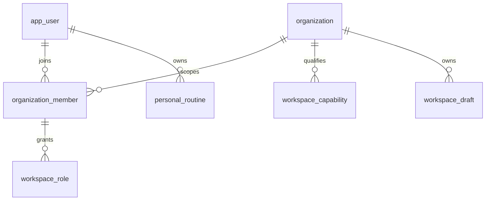

# Analysis-first application build

**Current catalog addendum:** [Contextual commerce and Snap & List](contextual-catalog-build.md). Analysis stays first; every relevant result includes recommendations, organic and separately labeled sponsored opportunities or an honest no-match state. Optional purchase does not mean hidden recommendations. Merchant AI suggestions require factual review and version approval before publication.

5 November 2026, Africa/Johannesburg. The user's instruction to code/build the supplied briefs authorizes application development now, with external tools and hosted databases connected afterward. It supersedes earlier waiting-for-design-approval text for this build. No release, provider spend, marketplace/advertising activation, Git publication or environment publication is implied.

Authoritative direction: [product correction](sources/2026-11-analysis-first-correction.txt), [dashboard/role architecture](sources/2026-11-unified-workspace-architecture.txt), [design correction](sources/2026-11-analysis-design-correction.txt), [market assessment](sources/2026-11-market-readiness-assessment.txt). Newest explicit user instruction governs quoted older approval conditions in these sources. Preserve the editorial design language; no attractiveness scores, inferred identity, medical claims or fake analysis/commerce evidence.

Four application surfaces share existing identity/backend/migrations: Expo consumer/mobile role companion; responsive Next.js consumer; unified `/business` portal; restricted `/admin`. No separate business mobile apps or duplicate users/ledgers.

Primary mobile: Home · Analyze · AI Studio · AI Advisor · Profile. Consumer web: Home · Face Analysis · Color Analysis · AI Studio · My Glow-Up Guide · AI Advisor. Core flow: selected photo and purpose/rights → quality guidance → goals → qualified provider processing → personal report → color report → editable guide → makeover comparison → saved results. Unconnected inference stays unavailable; image dimensions are technical checks, not a lighting or facial-quality model. Sample editorial images never become personal results.

## Identity and organization model

One Google/Supabase identity can join many organizations; organizations can qualify multiple business capabilities. Role/capability grants originate from trusted server administration, never a client workspace selector. Existing organizations/members remain canonical. An inactive membership, suspended organization, unverified capability or insufficient role denies access immediately, including after switching. Organization creation gives no verified business capability or age assurance.

## Permission and access matrix

| Role | Scoped actions | Restrictions |
|---|---|---|
| Owner/admin | Organization's qualified workspaces and draft management | No self-verification, privileged finance execution or platform admin |
| Catalog manager | Merchant drafts/catalog planning | No campaign billing or another tenant |
| Campaign manager | Advertiser draft planning | No spend/launch while unqualified |
| Booking manager | Professional service/quote drafts | No confirmed slot/payment without evidence |
| Creator | Creator drafts/publication planning | Rights/moderation qualification before publication |
| Affiliate | Partner link/disclosure drafts | No unverified sales/commissions |
| Analyst | Read qualified organization workspaces/drafts | No mutations or private consumer reports |
| Finance manager | Scoped finance view | No payment/payout execution or inferred balances |
| Admin roles | Restricted internal console with separate trusted authorization | No grants from business ownership or client navigation |

All HTTP requests verify issuer/subject and resource owner or organization membership; no role from a supplied workspace/organization ID. Administrative functionality remains denied until a separately authorized staff integration is connected. No consumer face/report data appears in business projections.

## Switching state machine

Personal → request workspaces → authenticated memberships/capabilities → choose allowed organization + workspace → server revalidation → active context. Changing context clears unsaved business inputs and selections; cancellation retains the original context. Expiry/suspension/revocation → denied/reset personal; error does not reuse prior-tenant records. UI may display the public module inventory but never populate real records or enable business persistence without authorized access.

## Delivery sequence and acceptance

1. Implement shared typed navigation, core consumer state, technical photo checks, routines, personal privacy and isolated source imagery; no AI result fabricated. Core interactive consumer flow first.
2. Implement canonical multi-role membership/capability checks, scoped business drafts and owner routines, audit and fail-closed integration boundaries. Test cross-tenant, read-only, multi-organization, suspension/revocation and direct-client RLS.
3. Use the approved core components for role-specific responsive dashboard/module screens, draft forms and workspace switching; display unavailable business evidence truthfully. Business activation remains deferred; full commerce/advertising execution is not shipped before core qualification.
4. Connect selected identity/storage/providers/catalog/payments through the named ports after secure configuration. Qualify report uncertainty/corrections, identity-preserving simulations, deletion, global/age/guardian policy and pilot results before activation.

Youth and unknown-age production photo processing/business activation remain unavailable until jurisdiction/assurance/guardian qualification. A checkbox or Google login cannot establish eligibility. No raw selfies or access tokens enter localStorage, analytics, business drafts or advertising. Browser photo previews are session-local object URLs, revoked on replacement/delete/unmount; native capture integration is explicit and deferred if no camera module is configured.

The disconnected client can edit/save session routines, follow selected interests, select and clear a browser photo, navigate every core screen and inspect role module task forms. It must clearly distinguish an editable local draft from a saved server record, an uncomputed report from an AI result, and a request from a confirmed booking. Core screen lifecycle variants include idle, loading, empty, offline, denied and failed; success is reserved for real local edits or server-confirmed writes.

## Competitor parity and validation

| Published capability described in supplied brief | Build target | Evidence needed before release |
|---|---|---|
| Selfie capture | Consent, safe browser selection, technical validation, native adapter boundary | Camera/device and provider quality evaluation |
| Face / tone / color analysis | Dedicated report/color routes, uncertainty/correction contract | Qualified real inference; no diagnosis or score |
| Glow-up previews / hair / makeup match | Distinct tools, style/intensity and comparison | Consented provider output and fidelity benchmark |
| Guides / routines / advisor | Editable routines and contextual guide, advisor input | Qualified grounded advisor; optional shopping separation |
| Saved history | Owner-scoped routines, empty report history until connected | Persistent report/storage lifecycle and deletion |
| Optional products / professional offers | Secondary Complete / screenshot / budget / request interfaces | Source catalog/full-cost/availability evidence |
| Celebrity lookalikes | Style inspiration only | No face identification/identity matching |

Business verification lifecycle: draft application → submitted evidence → trusted review → approved capability/expiry → suspension/reverification. No public approval endpoint is provided before staff authorization/MFA/audit integration. Invitations require a separate verified-recipient/expiry/acceptance flow; this build must not silently turn an invitation into active membership. Recipient-bound invitation issue/list/accept/revoke and scoped role revocation are now implemented and tested. Notification delivery, verified age assertion acquisition, provider inference, live commerce, publication and trusted staff provisioning remain connection/qualification work. The server exposes a separate staff context only with expiring staff grants and fresh signed AAL2/auth_time; operational staff actions remain disabled.

Security checklist: canonical migration head; owner and tenant checks on every operation; deny unknown capabilities; revalidate membership; no member enumeration to outsiders; bounded allowlisted drafts; scoped audit; no private media in business payloads; direct client RLS; no client role grants; finance/AI/booking unavailable without authority; keyboard, focus, contrast, image deletion and responsive/native tests. Market readiness needs actual users, measured AI and merchant supply; application compilation is not market readiness.
