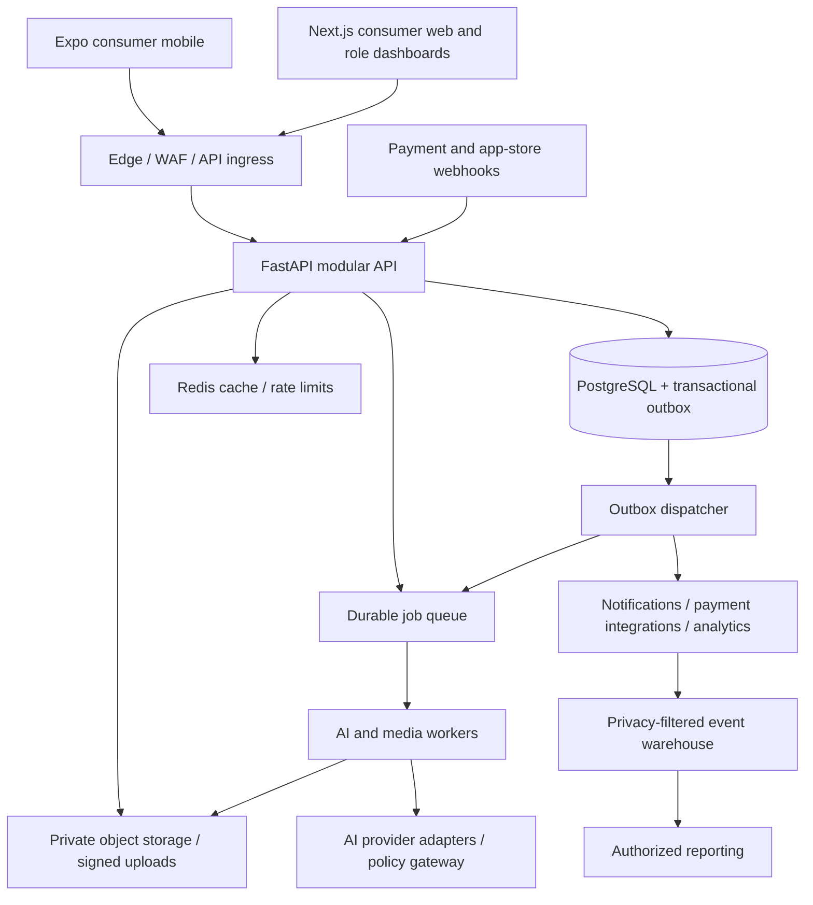

# Proposed architecture

## System boundaries

Start with a modular monolith and independently scalable workers. Distributed microservices would add operational and transactional complexity before traffic or team boundaries justify it. Modules own their tables and service APIs; a single migration directory owns the complete schema. Web/mobile clients never write commercial or authorization data directly.



The database outbox is the authoritative work handoff; the API transaction writes the job and outbox record together. The diagram's API-to-queue edge represents dispatch through this mechanism, never a nontransactional dual write. Redis is disposable, not the balance ledger or the only job queue. Use a managed durable queue with visibility timeouts, retry limits and a dead-letter queue; provider and regional availability decide the product.

### Components

| Component | Responsibilities / constraints |
|---|---|
| Expo / React Native | Camera permissions, guided capture, consent, upload, progress, results, commerce; secure OS token storage; no secret API keys |
| Next.js | Consumer discovery/web checkout where permitted; merchant, professional, creator, advertiser and admin portals; server-side session handling; no shared cached private responses |
| Identity integration | Google through Supabase Auth, OIDC/OAuth with PKCE; exact-project token validation at API; server organization memberships/scopes; MFA required for privileged roles; connection deferred |
| FastAPI modules | Identity, consent/media, analysis, catalog/recommendations, subscriptions/credits, orders/marketplace, creators, ads, trust/support |
| Complete the Look modules | Look Decomposition, Product Matching, Professional Matching, Sponsored Ranking, Attribution, Advertising Billing and Shopping Orchestration in the same backend; existing identity, catalog, consent, ledgers and orders remain canonical |
| Workers | Image validation/sanitization, analysis/generation, reconciliation, deletion, notifications; isolated credentials and resource pools |
| PostgreSQL | Supabase-managed PostgreSQL selected; local PostgreSQL until connection setup. Canonical Alembic migrations, server-only financial/private tables, row constraints/locking, backups and restore |
| Private object store | Quarantine/source/output namespaces, encryption, lifecycle rules, no public buckets; signed object access after authorization |
| Event warehouse | Allowlisted pseudonymous events; no face images, face geometry, appearance traits or raw sensitive prompts; purpose-filtered ingestion |
| Observability | OpenTelemetry traces, metrics, structured redacted logs, error reporting, paging, cost/quality dashboards and audit trails |

Initially use one write region and redundant availability zones. Prefer the launch region only after vendor availability, latency and cross-border privacy review. Global distribution begins with public static assets and product media, not replication of customer facial images. Add read replicas, partition events and independently scale worker pools when measured needs justify them.

## Repository structure

```text
Glamit/
  apps/
    mobile/                         # Expo consumer application
    web/                            # Next.js consumer web + scoped dashboards
  services/
    api/app/modules/                # FastAPI domain modules
    worker/app/                     # task execution + provider adapter runtime
  packages/
    contracts/                      # OpenAPI-derived client types; no alternate schemas
    ui/                             # tokens and platform-appropriate components
    policy/                         # versioned non-secret feature/country configuration
  db/
    migrations/                     # ONLY canonical Alembic migration history
    seeds/                          # clearly marked development fixtures, no real images
  tests/
    integration/  e2e/  security/  contract/  performance/
    ai-evaluation/                  # consented dataset manifest; media stored privately
  infra/
    terraform/  environments/  dashboards/  runbooks/
  docs/
    requirements/  backlog/  adr/  privacy/  release-gates/
  .github/workflows/
```

Use a locked JS workspace and Python lockfile with versions selected and pinned in Phase 1 against supported Expo/React Native/Next.js/FastAPI combinations. Keep Python migrations authoritative; no Prisma/Django second schema history. Generate TS clients from FastAPI OpenAPI and test drift. Country/currency settings are versioned server configuration, not client switches that change prices. Use the task's existing checkout; no additional Git worktree is necessary. After initial repository creation, each feature uses an isolated branch and a reviewable PR.

## AI orchestration and media workflow

The confirmed onboarding flow is Google sign-in → explicit consent and guided camera capture → processing/results on the next screen, as specified in [ADR 015](../adr-015-supabase-google-capture.md). The scan is cosmetic analysis, not biometric login; no camera starts merely because login completes. Supabase/Google setup is deferred, and private object storage/provider choice is not inferred from database selection.

1. Issue a narrowly scoped upload grant only after capture-purpose consent. Enforce content type, size, checksum and upload ownership; upload to quarantine with a short expiry. Finalization verifies the actual decoded file, strips EXIF, rejects malformed media and disallowed content, and records object provenance.
2. Check service availability and quote the server-calculated credit price with a version and expiry. The user confirms that quote. In one transaction validate entitlements/consent, reserve credits, insert an immutable input reference and create a queued job plus outbox message.
3. A worker claims the job idempotently. Validate current consent and job cancellation before sending data. Select only providers approved for the requested processing location, purpose, retention terms and capability. Do not silently fall back to an unapproved provider or change the agreed price.
4. Give providers short-lived scoped image access or transfer image bytes over verified TLS; disallow general outbound URLs and provider use for training. Redact logs and scrub prompts of unnecessary personal data. Record adapter/model version, provider operation identifier, policy/price versions, timing, metered units and cost.
5. Validate output safety, decode/size and identity/style preservation. Store privately. Commit job success and capture the credit reservation once. Notify through outbox. Grant output access only to the owner or specifically authorized support flow.
6. On terminal failure release the reservation. Timeout alone does not prove the provider did not run: reconcile using the provider request ID before a retry or cross-provider failover. Unknown outcomes become `reconciling`, with a user-visible deadline and escalation, not unlimited holds. Recheck consent before making an output available.

Job states: `queued → running → succeeded | reconciling | failed | cancelled`; `reconciling → succeeded | failed`. Track attempts separately. Cancellation during an irreversible provider request may still incur vendor cost; product policy can release the user's credits while recording that cost. Outbox/inbox deduplication and unique operation keys provide effect-once business transitions over at-least-once delivery.

Feature/color analysis uses landmark/color extraction and guided lighting capture, with confidence/abstention. It must not infer race, ethnicity, medical conditions or identity. For African hair, model strand texture, density, length, style geometry and desired maintenance through voluntary selections plus image-derived suggestions. Do not equate hairstyle with ethnicity. Ask users to confirm uncertain observations. Rendering needs separate qualification for natural hair, cornrows, box braids, locs, lace-front wigs and protective styles. Never label an unsafe or unqualified general image edit as realistic virtual try-on.

## Subscriptions and credit accounting

Digital AI entitlements are distinct from physical goods, salon payments and advertising budgets. Determine Apple/Google billing obligations per product, storefront and jurisdiction before implementation; do not assume a web checkout can unlock paid in-app digital services everywhere.

The backend verifies app-store server notifications/receipts and payment processor webhooks, recording raw sensitive payloads only in an encrypted limited-retention store. Validate signature, freshness, issuer and expected account; deduplicate event IDs. The commercial event store maps external product IDs to versioned internal plans. Only verified events grant entitlements. Handle pending payments, renewals, grace periods, expiry, proration, refunds, chargebacks, revocation and out-of-order notifications through explicit state machines and scheduled reconciliation.

Credits use an append-only balanced ledger with lots for included, purchased and promotional credits; separate available, held, consumed, expired and reversed positions. Allocation policy proposes earliest expiry first, then purchased lots; final expiry/refund rules require country and app-store review. Credits are internal usage units, not cash or transferable stored value. Money and credits never share a journal. A unique `(operation_type, business_id)` prevents duplicate grants/captures/releases. Concurrent reservations lock the account or use serializable transactions; balances may not go negative. A provider job consumes no more than the accepted quote. Refunds generate compensating postings, never ledger edits. Chargebacks revoke unspent grants and can restrict the account; do not fabricate a negative spendable balance to recover already consumed value.

## Marketplace and creator commerce

The server stores versioned prices, currency minor-unit rules, tax classification, commission agreements, discount eligibility and FX quote references. Cart totals are estimates; checkout locks an expiring quote with line price, tax, discount, shipping, platform fee, creator commission and professional/merchant net. Use integer money units and currency-aware rounding with line/order reconciliation. Never sum different currencies without an explicit recorded FX conversion. Client totals are display only.

Prefer a licensed marketplace PSP supporting the launch country's connected-account onboarding, KYC, split settlement and dispute process. Do not hold funds as unlicensed escrow. If a PSP cannot support a country/product, keep those transactions disabled. Model payment authorization/capture, order acceptance, stock reservations, fulfillment, cancellations, returns, partial refunds, chargebacks and payable settlement independently. Payout release depends on verified capture and documented fulfillment/dispute rules. A balanced money journal allocates buyer funds to tax, platform revenue, seller/professional payable, creator payable and processing fees. Reconcile PSP balances, bank settlement and ledger totals daily.

Professional booking uses service-specific availability, timezone-aware slots, buffer times and expiring booking holds; a database exclusion/locking strategy prevents overlapping confirmed appointments for the same resource. Deposits, no-shows, reschedules and cancellations have disclosed versioned rules. Creator attribution proposes a consented last eligible click within seven days, fixed at checkout; no double commission with coupon rules. Store the agreement and attribution version. A refunded order reverses the associated commission; payout waits through the return/fraud period. Initial external affiliate links support attributable redirects and verified network postbacks only where a real contract/API exists. An unverified off-site purchase is not a sale.

## Advertising platform

Advertisers onboard into verified organizations with billing identity, roles, spend limits and creative review. Model campaign → ad group → ad → creative, with versioned targeting, landing URL allowlists, schedule/timezone, total/daily budgets and eligible placements. Merchants/professionals can promote approved products/services; creators disclose paid partnerships. Consent, campaign approval, inventory availability and billing readiness all gate delivery.

Initial placements: sponsored product cards, search/contextual beauty listings and a clearly separated feed slot. Display `Sponsored` and advertiser identity on every impression, including affiliate/creator commercial disclosures where applicable. Never export customer face media, landmarks, color/skin/hair analysis, body measurements or inferred biometric traits to advertisers. Start with coarse country/language, explicit nonsensitive interests and current page context. No sensitive audience builders, lookalikes from analysis, or cross-app tracking by default.

Complete the Look specifies a relevance-gated first-price CPC auction for dedicated sponsored slots, gated on audited measurement and billing approval; defer CPM optimization and complex auctions. Fixed-price sponsored collections use distinct contracts and earned-revenue rules. The server ranks eligible campaigns using relevance, bounded bid and pacing with deterministic versioned policies. Atomically reserve the maximum click charge before issuing a signed expiring placement token. Budget accounting includes outstanding delivery reservations, validated billable events and released expiries; concurrency must not overspend campaign or account caps. Details: [Look ranking and commerce](look-ranking-commerce.md).

Define event semantics before launch: a server delivery is not an impression. A proposed viewable display impression requires at least 50% visibility continuously for one second, subject to platform/privacy constraints; deduplicate via signed placement/session IDs. A click is an intentional validated interaction, deduplicated within a policy window. Exclude bots, repeated accidental taps, internal traffic and suspicious devices; do not fingerprint faces. CPC ledger debits only validated clicks, with adjustment entries for fraud. Delayed invalidation can credit advertisers. If client viewability cannot be verified, report delivery without calling it a viewable impression.

Conversions originate from verified server orders or signed partner postbacks. Proposed paid-ad window: last eligible click within seven days, no view-through initially. Record organic, affiliate and paid touches separately; allocate paid-ad credit once per conversion and define how creator payouts coexist. Deduplicate using order/conversion IDs. Reports show delivery, viewable impressions, valid clicks, spend, conversions, refund-adjusted revenue and attribution window; specify timezone, currency, freshness and invalid-traffic adjustments. ROAS uses attributed revenue with a declared tax/refund basis. Advertiser reports use aggregated cohorts with a proposed minimum of 50 people, suppress small cells and query differencing risks, and never expose user-level journeys. Final threshold requires privacy review. First-party operational linkage stays access-restricted and subject to consent/retention; advertisers cannot access it.

## Reliability and operations

The [Complete the Look architecture](complete-the-look.md) connects selected/generated looks to verified offers and professionals through private immutable decomposition and independent organic/sponsored paths. [Schema/API extensions](look-schema-api.md) remain in the same migration history and API. Shopping uses existing orders/bookings and compensating orchestration, not a new payment system.

Provisional launch targets: 99.9% monthly availability for core API/checkout; p95 non-AI API under 500 ms at declared load; interactive analysis p95 under 30 s and generation p95 under 120 s only if qualification supports it. Use async progress with realistic estimates. Initial load gate: 100 concurrent sessions, 20 API requests/s and 10 concurrent AI jobs, with quota-aware backpressure. Measure actual demand and revise before promising SLAs.

Use timeouts, circuit breakers, bounded exponential retries with jitter, per-user/provider quotas and job deadlines. Degraded mode keeps discovery and existing results available while disabling new paid generations if providers or credit accounting are unhealthy. Monitor queue age, completion/quality rates by model and consented evaluation cohort, payment lag, reconciliation mismatches, deletion backlog, consent failures and per-feature contribution margin. Proposed RPO ≤15 minutes, RTO ≤4 hours require restore drills. Maintain incident/on-call, payment incident, provider outage, rollback, privacy incident and deletion runbooks. No production deployment is implied by this proposal.
