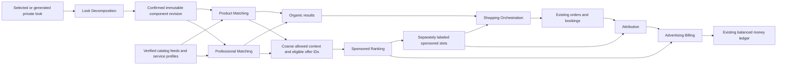

# Complete the Look Engine — revised requirements and architecture

V2 authority: [global Master PRD](master-prd-v2.md), [commerce operations](commerce-operations-v2.md) and [companion extension](style-companion-extension.md). Complete the Look is universal across user-selected grooming/hair/makeup/fashion/modest/adaptive/occasion styles; no inferred demographic restrictions. Screenshot to Shop, full delivered-cost budgets, owned wardrobe items, Style DNA/Occasion Concierge/agent proposals and professional feasibility extend the same canonical requirements. Verified Exact/Similar evidence and explicit confirmation replace guesses. Revised global/age architecture awaits approval; initial referral/lead pilots do not imply platform checkout, youth processing or live auctions.

Status: proposed extension to the GLAM AI approval package; no production implementation authorized. Prepared 3 November 2026. This feature is part of the existing consumer apps, dashboards, FastAPI modules, workers, private storage, PostgreSQL and single migration history. It is not a second application.

Companion designs: [schema and API contracts](look-schema-api.md), [ranking and commercial rules](look-ranking-commerce.md), [delivery, acceptance and economics](look-delivery-economics.md). These documents refine R05/R06/R07/R08 and add R13–R27. Where prior advertising design deferred auctions, the new proposal specifies a bounded first-price CPC auction, still gated on measurement/billing approval. No existing approval is inferred.

## Product contract

For every selected or generated look, offer an owner-authorized `Complete this look` action. Automatically prepare decomposition where the user has consented and cost policy permits; do not automatically charge credits, publish media or place orders. Decomposition describes what is needed to recreate a visual style, not what brand the photographed person actually wore. Exact SKU identification requires verified source metadata; otherwise label matches as compatible alternatives and communicate uncertainty. A style may be impossible to reproduce exactly from one image.

| ID | Requirement | Evidence / boundary |
|---|---|---|
| R13 | Decompose makeup, hair, beauty and fashion looks into versioned components | Required/optional/service/tool/consumable distinction, quantities or honest ranges, confidence, provenance and user correction |
| R14 | Match requirements to real product offers | Verified merchant SKU, currency, price basis, inventory source/time, delivery evidence; no invented availability |
| R15 | Match qualified professionals and services | Verified capabilities, service price basis, actual resources/slots/location, disclosed consultation limits |
| R16 | Localize offers by market | Shipping destinations, native currency, tax/import exclusions, local taxonomy/preferences, language and regional eligibility |
| R17 | Specialize African hair matching | Texture/length/density preferences confirmed by user; braiding pack quantity ranges, extension material, wig cap/lace/size options, care tools and professional skill evidence |
| R18 | Separate organic and sponsored recommendations | Independent organic ordering and clearly marked sponsored panels; sponsorship cannot alter decomposition, required quantities or confidence |
| R19 | Eligible relevance-first sponsored delivery | Approved campaigns/creatives, quality threshold, CPC bids, budget reservations, pacing and atomic frequency caps |
| R20 | CPC, affiliate and marketplace commerce | Signed event lineage, attribution windows, distinct revenue journals, refund/commission reversal; no unaudited external conversions |
| R21 | Compare, save and assemble looks | Compare landed known totals and uncertainties, substitutions, already-owned items, private shopping lists and partial completeness |
| R22 | Shop and book professionals | Revalidated quotes, stock/slot holds, multi-seller order groups, explicit external-checkout handoff and compensation for partial failures |
| R23 | Advertiser dashboard | Catalog health, campaigns, bids, spend, valid clicks, reconciled conversions, suppressed aggregates, invoices and controls |
| R24 | API/CSV/manual catalog ingestion | Staged schema validation, ownership/rights review, provenance, idempotent publish, freshness and deletion/tombstones |
| R25 | Private analysis and safe commercial context | No advertiser access to face media, geometry, appearance traits, private look images or sensitive inferences; no reverse targeting through reports |
| R26 | Auditable, fraud-resistant commercial state | Deduplication, immutable financial postings, daily reconciliation, spend caps and replayable policy versions |
| R27 | Creator storefronts and sponsored look collections | Versioned collection curation, rights, disclosures, affiliate agreements; never rewrite private AI analysis for a sponsor |

## Seven required services in the existing backend

Use logical domain services inside FastAPI first, with independently deployable workers where useful. They share canonical identities and contracts, not a second payment or customer database. Split deployments only when scale/ownership requires it.

| Service / module | Owns | Inputs and outputs / failure policy |
|---|---|---|
| Look Decomposition / `looks` | Look revisions, component graph, confidence/provenance | Authorized asset/generated result + consent + voluntary preferences → immutable decomposition. Provider-independent adapters, abstention and user confirmation; no campaign IDs, bids or revenue features in its inputs |
| Product Matching / `matching.products` | Candidate retrieval, offer evidence, compatibility explanations | Confirmed components + market → eligible variants/offers. Structured hard filters plus semantic retrieval/reranking. Unknown SKU/stock/price stays unknown; retrieval text is untrusted data |
| Professional Matching / `matching.professionals` | Service/capability matching and availability queries | Components + explicit location/date/radius → qualified services. Booking service remains sole slot/hold authority; no invented times or guarantees |
| Sponsored Ranking / `ads.ranking` | Eligible auction, delivery tokens, caps and budget reservation requests | Approved coarse commercial context and eligible offer IDs → labeled slots. Cannot mutate looks or organic ranks; refuses if privacy, consent or billing gates fail |
| Attribution / `attribution` | Consented touches, verified conversions and attribution snapshots | Signed clicks/redirects + real orders/postbacks → versioned channel attribution. No face-derived fields in its event schema |
| Advertising Billing / `ads.billing` | Spend reserves, validated CPC charges, adjustments/invoices | Valid events + auction price → existing money ledger postings. Independent of client totals; reconciliation with delivery/event records and PSP funding |
| Shopping Orchestration / `shopping` | Private lists, assemblies, quote groups and checkout saga | User selections → stock/slot/price revalidation → existing carts/orders/bookings/payment services. Explicit partial outcomes and compensations; no cross-merchant atomicity claim |

Catalog ingestion extends the existing catalog module; embedding/search indexes are rebuildable projections. Financial ledgers, consent, identity, inventory, bookings, subscriptions and outbox/inbox are reused. Matching workers read approved catalog revisions. Only catalog service publishes offers, only inventory/booking services issue holds, and only ledger posting functions move money/credits.

Private compatibility filtering stays in matching. Sponsored Ranking sees approved candidate identifiers and nonsensitive contextual relevance, not private traits or why other candidates were excluded. Advertiser-facing reports cannot expose exclusion reasons, per-user auctions or private component text.

## Look representation and African hair specialization

A revision includes source type, owner, originating AI job if any, processing consent, model/prompt/taxonomy versions and status `draft/needs_confirmation/confirmed/superseded/deleted`. Components have stable keys, category, required/optional flag, role, quantity/range/unit, constrained attributes, confidence, provenance (`verified_source`, `visual_inference`, `user_confirmed`) and dependencies/substitution groups. Separate visual observations from assumptions. A kit can satisfy several components through explicit coverage edges; one item may count once per physical quantity, avoiding double purchasing.

Example: a user-selected braided look may need a braiding appointment, extension material/color/length, an estimated 4–6 packs pending stylist confirmation, optional edge product, scalp-care product and maintenance tools. This is illustrative, not a fact about all braids. Pack sizes differ by merchant; quantities must reference pack weight/length and a professional-confirmed service recipe before presenting a firm requirement. Wigs need explicit cap/fit, fiber/human-hair claims, lace type, adhesive-free options and installation/service compatibility. Natural hair and loc styles need maintenance/accessory/service paths without assuming extensions are required. Do not infer scalp disease, ethnicity or medical suitability. Patch-test/allergy/traction risks receive qualified guidance and professional referral, not a diagnosis or safety guarantee.

Regional preferences are explicit user choices or aggregate nonsensitive catalog trends, not ethnicity inference. Support local terminology/synonyms, currencies, merchant density, pickup, delivery zones, professional travel radius and low-bandwidth use. Missing local offers produce `No verified match in this market`, with broaden-location or consultation options, never fabricated merchants.

## Consumer shopping and booking flows

1. **Select/generate → decompose:** explain processing and any quoted charge; reuse a consented immutable result where appropriate. Show progress, uncertainty and editable component cards. User confirms meaningful inferred quantities/fit attributes. Edits create revisions; old shopping decisions remain auditable.
2. **Complete the look:** show required/optional/owned/unmatched components, organic offers and a separate `Sponsored` panel. Explain compatible alternatives versus verified exact items. Show coverage as `5 of 7 required components selected`; incomplete does not mean unusable, and complete does not guarantee the visual outcome. Paid campaigns cannot add requirements.
3. **Compare offers:** normalize units/pack sizes, show merchant native amount/currency, tax/shipping known/unknown, delivery eligibility and evidence time, return policy and trust. Estimated currency conversion is display-only with dated FX. Do not label a price `cheapest delivered` when shipping/import costs are unknown. Do not add unlike currencies or overlapping kit prices.
4. **Assemble/save:** choose substitutions and quantities, mark owned components, save a private list and share only through explicit scoped grants. Revalidate saved offers on reopen; show unavailable/changed-price badges. No silent substitution or automatically increased quantities.
5. **Shop:** revalidate native prices, tax, stock, delivery and permitted merchant country. Show seller/payment groups, booking dependencies and whether checkout is on-platform or external. Quote expiry/price change requires confirmation. External items have independent checkout/returns and cannot count as platform-reserved inventory.
6. **Book:** select a professional with evidence for the required style/service; show actual slots, timezone, deposit, supplied-versus-bring-your-own materials and consultation conditions. Hold slot and dependent stock where supported. Do not promise coordinated arrival or appointment until confirmed; warn when delivery may follow appointment.
7. **Confirm/recover:** create parent orchestration and child orders/bookings. Compensate failed holds/authorizations; show partial success, pending refund/release and supported retry. Cross-PSP and external merchants cannot guarantee all-or-nothing checkout. Notify about material failure without silently replacing a professional or merchant.

Sponsored look collections are editorial/creator storefront entries with a sponsor label, commercial relationship and versioned merchant links. They can recommend curated items, but decomposition of a user's private look remains separate and unchanged. Buying from a collection may generate a commission only under an eligible disclosed agreement.

## Catalog ingestion and truth contract

API, CSV and approved manual entry all create the same staged feed/revision records. Require external SKU, seller identity, destination market, native currency and tax basis, product identifiers where available, attributes/pack units, price, stock evidence or explicit unknown status, delivery policy and source timestamp. Price updates cannot be supplied by the decomposition model. AI can suggest normalized labels but cannot invent commercial fields or self-publish a feed.

Validate tenant ownership, identifiers, schema, currency exponent, nonnegative values, URL/media rights and taxonomy; mitigate spreadsheet formula injection on import/export, ZIP/image bombs and SSRF in feed URLs. API credentials are scoped; HTTP fetches use approved destinations, size/time limits and conditional requests. CSV files use signed uploads and a dry-run row-error report; manual edits require an authorized merchant and review. Store original evidence securely, content hashes and per-field provenance; do not expose feed secrets in reports.

Publishing is atomic per validated batch or explicitly declared per-row acceptance policy. Replays use `(merchant, source, batch_key)` plus content hash; duplicate keys with changed payload fail. Sequence/source versions prevent late feeds overwriting newer records. Full-feed deletion is allowed only after complete successful traversal; truncated feeds cannot mark unseen SKUs unavailable. Incremental removal uses tombstones. Maintain idempotent outbox projection updates.

Proposed freshness: API stock ≤15 minutes, API prices ≤1 hour; merchant-attested CSV/manual price/availability ≤24 hours, shown as such. Merchant/category-specific stricter limits override these defaults. A fresh assertion is evidence from a merchant, not a delivery guarantee. Expired evidence removes `available`/sponsored eligibility; permit an explicitly `availability unknown — check merchant` organic listing if policy allows, without checkout or availability claims. Delivery status is `eligible/ineligible/unknown`, with source and expiry. At checkout query/reserve authoritative stock and obtain a valid shipping quote; where unsupported, use an external handoff. Delivery estimates must be provider/merchant-backed, never model-generated. Final TTLs and merchant SLAs require approval.
