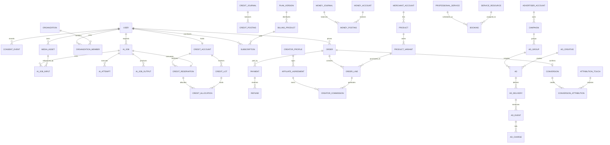

# Canonical logical database model

This is a complete logical entity inventory for the proposed scope, not executable migrations. Phase 1 must translate approved invariants into PostgreSQL constraints and migration tests. One Alembic history under `db/migrations` governs all transactional modules. An analytical warehouse is a derived projection, never an alternative authority for billing.

Canonical scope includes the [Complete the Look schema delta](look-schema-api.md): look/component revisions, verified market offers/feed evidence, matching, shopping lists/assemblies, checkout orchestration, sponsored collections and auction/budget/frequency records. These extend this database/history without parallel ledgers, inventory or recommendation authorities.

The uploaded master adds explicit advisor/routine/feedback/session/incident domains. [Master alignment](master-alignment.md#upload-specific-model-additions) specifies their columns, FKs, invariants and deletion boundaries: analysis_result, analysis_feedback, ai_conversation, ai_message, beauty_routine, routine_step, routine_progress, referral, provider_incident and user_session. These are proposed logical extensions under this same history, not installed tables. `user_session` is a revocation/audit projection of Supabase sessions, not a second identity authority; shared `ai_job` and balanced journals remain canonical.

Notation: every entity has UUID `id`, `created_at`, and appropriate audit/version fields unless a composite key is stated. `→` identifies an FK; `?` is nullable. All references below target the named entity's `id` unless specified. Money is integer minor units plus ISO currency; rates use fixed precision decimals, never binary floats. Times are timezone-aware UTC; business timezone and original local appointment date are recorded separately. Junction FKs are unique pairs unless otherwise stated. Sensitive fields are minimized and encrypted where needed. No image bytes or persistent face identity embeddings belong in PostgreSQL.

## Identity, tenancy and consent

| Entity | Essential columns and relationships |
|---|---|
| user | auth_subject unique with issuer, account_state, locale, country, age_eligibility_state; avoid full birth date unless legally required |
| user_profile | user→user unique, display_name, optional preferences; private profile distinct from published creator profile |
| organization | kind: merchant/professional/creator/advertiser/platform, legal_name, country, verification_state |
| organization_member | organization→organization, user→user, state; unique organization/user |
| role | code unique, scope_type; no user-provided arbitrary privileges |
| permission | code unique |
| role_permission | role→role, permission→permission |
| member_role | member→organization_member, role→role |
| platform_role_assignment | user→user, role→role, approved_by→user, expires_at?; privileged grants audited |
| policy_document | kind, version, locale, content_hash, effective_at; unique kind/version/locale |
| consent_event | user→user, policy→policy_document, purpose, action granted/withdrawn, timestamp, collection_context; append-only |
| user_preference | user→user, key, value, purpose; unique user/key; not a substitute for consent |
| data_request | user→user, kind access/export/delete/correct, state, due_at, completed_at? |
| retention_hold | subject_user→user?, object→media_asset?, case→support_case?, legal_basis, expiry, approver→user; scoped legal exception |
| audit_event | actor_user→user?, actor_service, organization→organization?, action, resource_type/id, trace_id, redacted change metadata; append-only |
| idempotency_record | principal_scope, route, key, request_hash, response_ref, expires_at; unique scope/route/key |

## Private media and AI

| Entity | Essential columns and relationships |
|---|---|
| upload_session | owner→user, purpose, consent→consent_event, object_key, size_limit, checksum, expires_at, state |
| media_asset | owner→user, upload→upload_session?, parent→media_asset?, private_object_key unique, purpose, content_hash, lifecycle_state, delete_after, encryption_key_ref; product media still requires a separate publication decision |
| media_access_grant | asset→media_asset, grantee_user→user?, grantee_service?, scope, reason, expires_at, revoked_at?; bounded support/provider access |
| style_taxonomy | parent→style_taxonomy?, kind, stable_code, localized_labels, maintenance metadata; natural/braid/loc/wig/protective style coverage |
| style_reference | taxonomy→style_taxonomy, media→media_asset, rights/license_record, consent_scope, publication_state |
| model_version | provider, model_name, version, capabilities, region, policy_state, evaluation_report_ref, effective_at |
| ai_price_version | feature, model_policy_version, credits, estimated_cost_currency/amount, valid_from/to; immutable once quoted |
| ai_quote | user→user, price→ai_price_version, feature, parameters_hash, credits, expires_at |
| ai_job | user→user, quote→ai_quote unique, reservation→credit_reservation unique, state, consent→consent_event, deadline, completed_at? |
| ai_job_input | job→ai_job, media→media_asset, input_role; unique job/input_role/index |
| ai_attempt | job→ai_job, model→model_version, attempt_no, provider_request_id?, state, billed_units, vendor_cost, currency, error_category; unique job/attempt_no and provider/request_id when present |
| ai_job_output | job→ai_job, media→media_asset, attempt→ai_attempt, output_role, quality_state |
| analysis_result | job→ai_job unique, encrypted/minimized cosmetic_attributes, confidence, schema_version, delete_after; purpose-bound, never ad targeting |
| recommendation_set | user→user, analysis→analysis_result?, algorithm_version, purpose, expires_at |
| recommendation_item | set→recommendation_set, product_variant→product_variant?, professional_service→professional_service?, rank, nonsensitive explanation; exactly one target |
| ai_evaluation_run | model→model_version, dataset_manifest_ref, consent/license_version, metrics_ref, evaluator, approved_state; private evaluation media is separately governed |
| moderation_case | media→media_asset?, creative→ad_creative?, listing→product?, subject_user→user?, reason, decision, reviewer→user?, appeal_of→moderation_case? |

## Catalog, professionals, community and creators

| Entity | Essential columns and relationships |
|---|---|
| merchant_account | organization→organization unique, verification_state, PSP_account_ref?, country |
| country_policy | country_code unique, enabled_products, supported_currencies, policy_version, legal_approval_ref; disabled until approved |
| user_address | user→user, encrypted_address_fields, country_code, purpose, deleted_at?; minimal delivery/contact data |
| address_snapshot | owner_user→user?, encrypted_address_fields, purpose, retention_until; immutable order billing/shipping snapshot, separate from mutable address book |
| catalog_category | parent→catalog_category?, stable_code unique, localized_labels, tax_class_default |
| brand | owner_organization→organization?, name, verification_state |
| product | merchant→merchant_account, brand→brand?, category→catalog_category, title, claims_review_state, publication_state |
| product_variant | product→product, merchant_sku, attributes, active; unique merchant/SKU enforced via ownership key |
| product_price | variant→product_variant, currency, amount, tax_class, effective_from/to; immutable historical prices |
| product_media | product→product, asset→media_asset, usage_rights, order_index, publication_state; only expressly public product assets delivered publicly |
| inventory | variant→product_variant, location_code, on_hand, reserved, version; unique variant/location, nonnegative quantities |
| inventory_reservation | variant→product_variant, order_line→order_line?, quantity, expires_at, state |
| shipping_policy | merchant→merchant_account, version, origin_country, service_zones, carrier_policy, effective_dates |
| shipping_quote | policy→shipping_policy, checkout_quote→checkout_quote, seller→organization, service, amount, currency, tax_snapshot, expires_at |
| tax_policy_version | jurisdiction, product_tax_class, effective_dates, calculation_provider_ref?, rule_version, evidence_ref; immutable calculation policy, rates finalized by tax review |
| professional_profile | organization→organization, public_bio, verification_state, insurance/license_refs? |
| service_location | organization→organization, address, timezone, service_area, accessibility metadata |
| professional_service | profile→professional_profile, location→service_location, duration, buffers, taxonomy→style_taxonomy?, active |
| service_price | service→professional_service, currency, amount, deposit_policy_version, effective_from/to |
| service_resource | profile→professional_profile, location→service_location, kind staff/chair, active |
| availability_rule | resource→service_resource, local_weekday/window, timezone, valid_dates |
| availability_exception | resource→service_resource, start/end, available flag |
| booking | customer→user, service→professional_service, resource→service_resource, order_line→order_line? unique, start/end, local_timezone, state, hold_expires_at, cancellation_policy_version |
| review | author→user, order_line→order_line unique, rating, text, moderation_state; verified fulfilled purchase only |
| creator_profile | organization→organization unique, user→user?, public_handle unique, disclosure_state |
| creator_post | creator→creator_profile, caption, publication_state, commercial_disclosure, moderation_state |
| post_media | post→creator_post, asset→media_asset, position, explicit_publication_consent→consent_event? |
| post_product | post→creator_post, variant→product_variant, position |
| creator_follow | follower→user, creator→creator_profile |
| saved_item | user→user, post→creator_post?, product→product?, service→professional_service?; exactly one target |
| content_report | reporter→user, post→creator_post?, review→review?, reason, state; exactly one target |
| user_block | blocker→user, blocked→user |
| affiliate_agreement | creator→creator_profile, merchant→merchant_account?, network_ref?, version, rate_type/value, currency?, effective_dates, return_hold_days |
| affiliate_link | agreement→affiliate_agreement, post→creator_post?, target_variant→product_variant?, approved_external_url?, token unique |
| affiliate_touch | link→affiliate_link, user→user?, consent→consent_event?, pseudonymous_session, clicked_at, expires_at |
| external_conversion | network, external_event_id unique within network, link→affiliate_link, verified_state, amount, currency, reversed_at? |
| creator_commission | agreement→affiliate_agreement, order_line→order_line?, external_conversion→external_conversion?, touch→affiliate_touch, amount, currency, state; exactly one source; unique agreement/source |

## Commerce, subscriptions and balanced ledgers

| Entity | Essential columns and relationships |
|---|---|
| plan | code unique, audience, active |
| plan_version | plan→plan, version, benefits, included_credits, entitlement_rules; unique plan/version |
| billing_product | plan_version→plan_version?, channel, country, currency, external_product_id, price, product_kind subscription/credit_pack; unique channel/external ID/country |
| subscription | user→user, product→billing_product, external_subscription_ref unique by channel, state, current_period, next_reconcile_at |
| entitlement | user→user, subscription→subscription?, source_event→commercial_event, code, valid_from/to, revoked_at?; idempotent grant per source/benefit |
| commercial_event | provider, external_event_id, kind, verified_at, subject_ref, payload_hash, encrypted_payload_ref?; unique provider/event_id |
| credit_account | user→user unique, cached_available, cached_held, version; caches reconcile to journal |
| credit_lot | account→credit_account, source_event→commercial_event?, kind purchased/included/promo, granted_units, expires_at?, currency_paid?, monetary_value? |
| credit_reservation | account→credit_account, quote→ai_quote unique, state, units, expires_at |
| credit_allocation | reservation→credit_reservation, lot→credit_lot, units; unique reservation/lot |
| credit_journal | operation_type, business_id, reversal_of→credit_journal?, effective_at; unique operation_type/business_id |
| credit_posting | journal→credit_journal, account→credit_account?, lot→credit_lot?, bucket, signed_units; balanced globally per journal across user/system buckets |
| checkout_quote | buyer→user, currency, expiry, version, pricing_policy_version, totals, FX_reference? |
| cart | buyer→user, currency, state, version; not an authoritative price or stock hold |
| cart_line | cart→cart, variant→product_variant?, service→professional_service?, quantity; exactly one target; slot availability held separately |
| checkout_quote_line | quote→checkout_quote, variant→product_variant?, service→professional_service?, tax_policy→tax_policy_version, quantity, price_snapshot, tax_snapshot, discount_snapshot, commission_snapshot; exactly one product/service |
| discount_rule | organization→organization?, code, version, eligibility, funding_party, effective_dates, redemption_limit |
| discount_redemption | rule→discount_rule, buyer→user, order→order, amount; unique rule/order and transactional limits |
| order | buyer→user, quote→checkout_quote unique, currency, state, immutable totals, billing_address→address_snapshot?, shipping_address→address_snapshot? |
| order_line | order→order, quote_line→checkout_quote_line unique, seller→organization, quantity, immutable item/price/tax/fee/commission snapshots, state |
| payment | order→order?, advertiser→advertiser_account?, billing_product→billing_product?, provider, external_payment_ref, state, amount, currency; exactly one business purpose; unique provider/external ref |
| refund | payment→payment, external_refund_ref?, state, amount, currency, reason; unique external ref; no over-refunding |
| refund_allocation | refund→refund, order_line→order_line?, creator_commission→creator_commission?, component, amount |
| customer_invoice | order→order?, subscription→subscription?, payment→payment, issuer→organization, legal_invoice_number, currency, tax/fee snapshots, issued_at, document_ref; unique issuer/legal number |
| credit_note | invoice→customer_invoice, refund→refund, legal_number, tax/amount snapshots, document_ref; immutable fiscal reversal |
| dispute | payment→payment, external_case_ref unique by provider, reason, state, evidence_deadline, disputed_amount |
| fulfillment | order→order, seller→organization, kind shipment/service/digital, state, carrier_ref?, tracking_ref? |
| fulfillment_line | fulfillment→fulfillment, line→order_line, quantity |
| return_request | order_line→order_line, quantity, reason, state, refund→refund? |
| money_account | organization→organization?, user→user?, account_kind, currency, provider_ref?; unique owner/kind/currency |
| money_journal | event→commercial_event?, operation_type, business_id, reversal_of→money_journal?, currency; unique operation/business_id |
| money_posting | journal→money_journal, account→money_account, signed_amount; balanced per journal/currency |
| payable | account→money_account, order_line→order_line?, commission→creator_commission?, amount, currency, eligible_at, state |
| payout | organization→organization, provider_ref unique by provider, amount, currency, state |
| payout_allocation | payout→payout, payable→payable, amount; prevent double settlement |
| reconciliation_run | provider, scope, period, state, report_ref, completed_at? |
| reconciliation_item | run→reconciliation_run, payment→payment?, payout→payout?, external_ref, mismatch_kind, resolution_journal→money_journal? |

## Advertising, events and operations

| Entity | Essential columns and relationships |
|---|---|
| advertiser_account | organization→organization unique, verification_state, billing_account→money_account, spend_cap |
| campaign | advertiser→advertiser_account, objective, state, currency, total/daily_budget, start/end, timezone, policy_version |
| ad_group | campaign→campaign, contextual_target_rules, bid_type/value, state |
| ad_creative | advertiser→advertiser_account, asset→media_asset?, text, approved_landing_url, version, moderation_state |
| ad | group→ad_group, creative→ad_creative, product→product?, service→professional_service?, state |
| placement | code unique, format, disclosure_template_version, eligibility_policy |
| ad_delivery | ad→ad, placement→placement, pseudonymous_session, signed_nonce unique, selected_at, expires_at, pricing_version |
| ad_budget_reservation | delivery→ad_delivery unique, campaign→campaign, amount, currency, state, expires_at |
| ad_event | delivery→ad_delivery, kind, event_nonce, observed_at, verified_at?, invalid_reason?; unique delivery/kind/dedup_key |
| attribution_touch | user→user?, pseudonymous_session, ad_event→ad_event?, affiliate_touch→affiliate_touch?, channel, consent→consent_event?, expires_at; no appearance traits |
| conversion | order→order? unique, external_conversion→external_conversion? unique, amount, currency, state; exactly one source |
| conversion_attribution | conversion→conversion, touch→attribution_touch, model_version, attribution_role, eligible_revenue; unique conversion/model/role for single-touch policy |
| ad_charge | event→ad_event unique, reservation→ad_budget_reservation, journal→money_journal, state, adjustment_of→ad_charge? |
| advertiser_invoice | advertiser→advertiser_account, period, tax_details_snapshot, currency, journal_ref, state |
| report_snapshot | advertiser→advertiser_account, campaign→campaign?, range, timezone, currency, metrics_version, as_of, privacy_threshold, artifact_ref |
| event_inbox | source, event_key, received_at, handled_at?, result_ref; unique source/event_key |
| outbox_event | aggregate_type/id, event_type/version, redacted_payload, available_at, sent_at?, attempts |
| notification | user→user, kind, template_version, purpose, channel, state, provider_ref? |
| support_case | requester→user, assigned_to→user?, type, state, restricted_evidence_ref? |
| feature_flag | key, country, rollout_policy, version, kill_switch, approved_by→user |

### Relationship overview

The diagram is a navigational subset; the entity tables define the full logical relationship model, including optionality. Catalog entities may have zero variants while in draft; publication requires at least one. Conditional one-to-one relationships, such as an order conversion or job reservation, are enforced on the corresponding workflow transition rather than assumed for incomplete drafts.

## Cross-cutting constraints

- Tenant ownership travels through all organization-owned rows. Use composite tenant/resource FKs or equivalent constraints to prevent cross-tenant references, plus authorization and RLS where supported. Public catalog reads require explicit publication state. Consumer private media remains owner-scoped even when attached to a professional support case.
- Balanced money and credit journals commit with all postings in one transaction. Enforce balance using deferred constraint triggers or a narrowly privileged posting function; restrict direct writes. Enforce money account currency agreement and positive allocation limits. Append reversals, never overwrite posted financial entries. Materialized balances are repairable from journals.
- Foreign keys do not cascade-delete legal financial evidence. Account deletion anonymizes retained orders/journals and removes sensitive profile/media links under a documented lawful retention schedule. A consent reference must not force retention of deleted facial assets.
- Enforce non-overlapping resource bookings for active holds/confirmed slots, nonnegative inventory, no expired quote redemption, single capture/release per credit hold, refund/settlement limits and campaign spend ceilings under concurrency.
- Price, plan, agreement, tax, model and consent versions are immutable historical records once referenced. Add indexes for tenant/time, active jobs, job deadlines, external event IDs, delete_after, outbox availability, and financial reconciliation. Partition high-volume events after measurement; retain uniqueness semantics across partitions.
- Data retention: propose raw captures 24 hours after job completion or terminal failure, unsaved outputs 7 days, saved looks 90 days unless renewed/deleted, analysis traits 30 days by default with explicit opt-in for personalization. Quarantined/abandoned uploads expire within 24 hours. Failures/retries must not reset retention indefinitely. Final periods require approval. Vendor deletion and backup ageing are separate tracked obligations.
- Consent withdrawal cancels pending processing, prevents new provider dispatch and queues deletion of inputs/outputs/traits covered by that purpose. Financial/audit records retain only lawful minimum data. Object deletion success, provider confirmation and backup expiry are evidence attached to the data request. See the privacy requirements for deadlines and exceptions.
