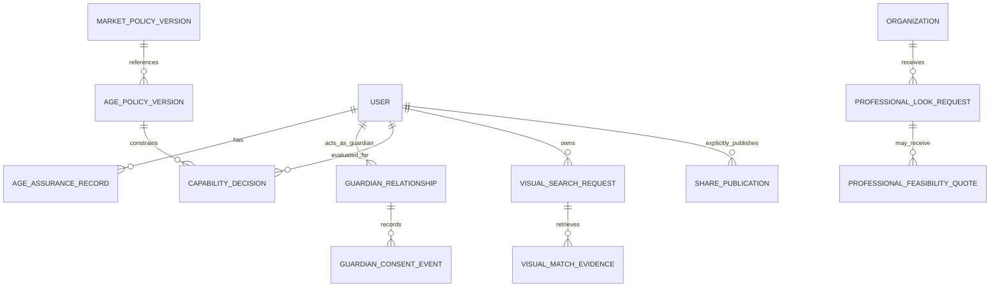

# Global eligibility, age permissions and localization architecture

**Current authority:** [Analysis-first build](analysis-first-build.md). The latest user instruction authorizes implementation now, then external connections. Face Analysis, Color Analysis, Glow-Up Guide and makeover lead the experience; Home · Analyze · AI Studio · AI Advisor · Profile replaces the earlier shopping-first navigation. One Expo app, consumer web, unified business portal and restricted admin share canonical identity/RBAC/backend/migrations. Older design-approval waiting and surface/navigation descriptions below are historical where they conflict; production activation/release gates remain.

The latest [UI/UX design brief](ui-ux-design-handoff.md) supersedes older surface/navigation/palette proposals **for design scope**: iOS, Android, responsive consumer web and separate merchant, advertiser, professional, creator and admin web workspaces. Mobile tabs are Home, Discover, Studio, Shop, Profile; Advisor is contextual. Fifteen admin UI groups map to the retained A01–A16 requirement IDs. Application implementation still awaits the required primary-flow/design-system and expanded-architecture review. Older mobile-only descriptions below record the preceding architecture baseline; the linked handoff governs current design scope.

5 November 2026 · Proposed PRD v2 implementation plan; no runtime policy or database migration is installed by this document. Governing scope: [Master PRD v2](master-prd-v2.md).

## Policy composition and lifecycle

Effective capability is the intersection of: authenticated owner/tenant action permission; enabled market/country; applicable storefront/legal region policy; verified age band/assurance; guardian relationship/scope where required; purpose-specific consent; source/likeness rights; qualified provider/model/processing region; feature availability; and accepted server quote/financial limits where relevant. UI receives an explanation/capability view, never authority to grant itself permission.

Market, legal jurisdiction, locale, delivery destination and app-store region are separate inputs. A reviewed jurisdiction-resolution policy determines applicable rules; ambiguous/conflicting evidence resolves to restricted access pending clarification rather than a permissive guess. Language, appearance, GPS alone or a client-supplied country/age cannot select a weaker policy. Avoid collecting precise location/identity documents where a scoped assertion suffices.

Every decision records policy versions, reason codes, evidence references/expiry and scoped purpose in private audit. Age/guardian details do not enter advertiser contexts or public share tokens. Do not infer age, race, ethnicity, gender identity, religion or disability from beauty photos. Prefer appropriately qualified privacy-preserving, non-biometric assurance; Google authentication alone does not establish age or guardianship.

Keep one canonical user/data-subject owner for private resources. The proposed identity model distinguishes authenticated accounts from managed-child subjects: authenticated accounts require verified issuer/subject; managed-child subjects have no independent OAuth identity or login/business authority and are accessed only through verified, limited guardian contexts. Existing `app_user` constraints do not yet implement this distinction. A reviewed additive migration and owner/session tests are prerequisites; do not invent a Google identity for a child or grant adult session permissions through a profile switch.

Check eligibility at login/context switch, private upload-intent/read issuance, quote acceptance, queue dispatch and output/share publication. Cache only within owner/purpose/version/expiry and invalidate on policy/consent/guardian/session changes. Policy and guardian revocation emit outbox events; consumers are idempotent and re-check the authoritative state before side effects. Revoke access, cancel queued work, request cancellation/deletion for in-flight work and track residual provider limitations. Cleanup and rights requests stay available even if a market is disabled. Kill switches stop new processing without hiding existing refunds, privacy rights or support.

## Age-specific permission matrix

Bands are defined by approved jurisdiction policy, not universal numeric thresholds. The following are proposed conservative initial modes; they are not claims about any country's current law. No age-specific mode is enabled by this document. “Conditional” always means explicit local legal/store/privacy/provider/product qualification; an unset condition denies the capability.

| Capability | Unknown/unverified age | Eligible adult | Restricted teen | Guardian-managed child |
|---|---|---|---|---|
| Generic editorial style inspiration | Non-personalized, age-safe content only where approved | Available when market enabled | Curated age-appropriate selection | Guardian-selected, curated inspiration |
| Account/session | No claimed adult privilege | Google/Supabase with required assurance | Jurisdiction-approved restricted route and consent | Verified guardian-managed child context; no reused unrestricted adult session |
| User-declared style/coverage/accessibility preferences | No persistent sensitive profile | Optional purpose-bound choices | Minimized, age-appropriate and deletable | Guardian-managed minimum needed; no sensitive profiling |
| Facial upload/analysis/makeup try-on | Denied | Conditional consent/rights/qualified provider/quote | Disabled in initial youth mode; separately reviewed bounded capability only | Disabled in initial child mode; no unnecessary facial collection/retention |
| Non-facial hairstyle/outfit inspiration or limited try-on | Generic editorial only | Qualified capabilities | Conditional age-appropriate, no body reshaping/pressure | Guardian-managed, limited qualified styling; image processing remains off until explicitly qualified |
| Open-ended advisor | Denied | Qualified cosmetic-only provider | Restricted templates/scope only after age-specific qualification | Curated guidance only; no unrestricted chat |
| Public profile/face/result sharing | Denied | Explicit per-asset publication permission/rights | Disabled initially; any later mode needs dedicated review | Denied; no public child profile |
| Sponsored recommendations | Suppressed | Only eligible consented nonsensitive explicit intent | Suppressed in initial teen mode; no personal profiling | Suppressed; no personalized ads or child-photo exposure |
| Purchases/credit use/booking | Denied | Store/legal/payment capability qualified | Disabled by default; lawful approved guardian/store authorization required | Guardian-initiated eligible transaction only; no child payment authority |
| Merchant/creator/advertiser/professional account authority | Denied | Verified eligible business role | Denied initially | Denied |
| Export/delete/consent withdrawal/support | Accessible appropriate rights/help route | Owner-verified rights | Age-appropriate rights and authorized guardian handling | Verified guardian/child rights process without exposing unrelated family data |

Guardianship requires independently qualified verification of authority/relationship and permitted scope, not a self-asserted checkbox or shared surname. Use separate subject contexts and authorization checks for each child; prevent sibling/other-household access. Record consent/assent as legally applicable, review disputes, expiry/reverification and adult transition. Revocation/expiry does not delete legally required evidence or prevent privacy-rights handling. Reaching a new age band triggers reviewed consent/permission transition; do not silently publish history or turn on marketing.

Always prohibit attractiveness rankings, sexualized/nonconsensual transformations, sensitive identity inference and deceptive endorsements. Preserve identity, natural skin tone, body proportions and visible features. No anti-aging/body-normalization default or inferred “problem” labels. User-requested permitted styling changes require explicit parameters and policy qualification; they do not authorize body reshaping for youth or prohibited edits for anyone.

## Localization and activation model

| Dimension | Canonical facts / acceptance |
|---|---|
| Language/RTL | BCP 47 locale, translated keys/plurals, fallback policy, bidi isolation for mixed-script names/amounts, mirrored navigation where appropriate, correct unmirrored images/media controls where meaning requires, text expansion and screen readers |
| Market/jurisdiction | Country capability manifest, legal/privacy/store/age policy version, support contacts, tax/returns basis, release status; unknown/unapproved is disabled |
| Money | ISO currency and exponent, integer minor units/Decimal calculations, source currency preserved; dated server FX for estimates only unless quote locks conversion; no adding mixed currencies without conversion basis |
| Tax/delivery | Seller/destination rules, VAT/tax-inclusive flag, customs/duties, delivery/pickup zones, merchant-group shipping, service area and arrival evidence; unknown means unconfirmed total |
| Size/measurements | Merchant-specific size-chart version, garment/shoe category, region/units, user-entered optional measurements and fit/coverage/accessibility preferences; no inferred demographic access rules or guaranteed fit |
| Catalog/content | Source/locale and translation provenance, category taxonomy with cultural expert review, style suitability/rights, localized descriptions without altering verified claims |
| Payments | Approved provider/method/country/currency/storefront combination, seller role, authorization/capture/refund/settlement evidence; no unsupported mobile-money/card/transfer promises |
| Time/booking | IANA timezone, local appointment/date and UTC event time, DST ambiguity handling, real resource availability/duration; notifications do not create reservations |
| Data region | Processing/storage/vendor region, legal-transfer/privacy approval and retention policy; global public content distribution is not permission to replicate private faces worldwide |

Illustrative configuration shape (not an active legal policy): market/country → release state and supported locales/currencies → versioned jurisdiction/age bands/assurance rules → per-capability prerequisites, provider regions, seller/payment routes and service areas. No example numeric age limits or invented enabled country is supplied. Defaults are disabled. Publication requires schema validation, reviewer authority/MFA, recorded approvals and immutable version activation/rollback. A feature flag cannot bypass an unmet prerequisite.

## Logical schema delta

Extend existing entities and the one `db/migrations` Alembic history. UUID identity, owner/tenant FKs, UTC timestamps, immutable referenced versions and purpose-limited retention apply. Do not introduce duplicate users, jobs, catalog authority or financial ledgers.

| Entity | Relationships / constraints | Data boundary |
|---|---|---|
| `market_policy_version` | Country, release state, jurisdiction refs, locales/currencies/capabilities, reviewer/activation; immutable referenced revision | Public capability projection excludes internal risk rules |
| `age_policy_version` | Jurisdiction/market → policy, bands/thresholds/assurance/guardian conditions and expiry; non-overlapping effective ranges | Legal/risk approval required; no universal hardcoded ages |
| `age_assurance_record` | Subject → canonical user/data subject, provider assertion/ref, band, assurance/expiry, policy; unique verified assertion lineage | Store minimal result/evidence ref, not raw ID photos or estimated demographics |
| `guardian_relationship` | Guardian → verified adult user, child → restricted canonical user/data subject, verification ref, scope, state/expiry/revocation | Isolated per child; no client-created permission grant |
| `guardian_consent_event` | Relationship → guardian relationship, purpose/policy version, subject, grant/withdrawal/assent refs; append-only | Existing consent authority extended, not replaced |
| `capability_decision` | Subject/context, action/resource scope, market/age/consent/rights/provider versions, outcome, expiry | Private authorization audit; never advertiser input |
| `localization_revision` | Key/locale/version, reviewed text and fallback; unique key/locale/version | No customer private content stored as public translation strings |
| `size_chart_revision` | Merchant/brand/product category, market/unit/measure ranges, source/version/expiry | Separate from optional private user measurements |
| `user_fit_preference` | Owner → user/profile, units/voluntary measurements/coverage/accessibility preferences, consent/deletion deadline | Optional private data; excluded from targeting and no identity inference |
| `visual_search_request` | Owner → user, rights/consent, private upload/asset, query component revision, market/policy, state | Private screenshot/derived representation with deletion/index tombstones |
| `visual_match_evidence` | Search/component → request, offer/SKU/source revision, Exact/Similar/Unknown evidence and model version | No “Exact” from similarity score alone |
| `professional_look_request` | Customer/professional organization, authorized shared-reference grant, occasion/service area, state/expiry | Private minimal style board; no blanket selfie access |
| `professional_feasibility_quote` | Request → look request, confirmed service/materials/duration/full cost/terms/revision/expiry | Customer acceptance not a slot/payment confirmation |
| `share_publication` | Owner → user/creator, approved style template/collection, rights/policy, explicit asset allowlist, revocable token | Private inputs excluded by default; no child publication |
| `merchant_verification_case` | Organization → organization, provider/check refs, review decision/expiry/appeal | Existing business verification authority; restricted identity evidence |
| `market_supply_evidence` | Market/capability/supplier, agreement/rights/feed/coverage/freshness/support refs, reviewer/status | Real evidence only; a candidate entry is not a partnership |

The guardian relationship also references its restricted child subject; store that FK separately from the adult guardian. Diagram is navigational; table constraints and backend permissions govern both sides. Retention for age/guardian verification evidence is separately approved and minimized; do not keep raw identity media as an easy audit substitute.

## API contract changes — proposed, not generated OpenAPI

| Contract | Server behavior / tests |
|---|---|
| `GET /v1/capabilities` | Safe current market/age-eligible action hints and policy version; no role/price grant; changing client response cannot enable action |
| Age-assurance begin/complete/status | Qualified redirect/assertion flow with nonce/state, provider verification and replay/expiry checks; never accept a self-declared adult claim as sufficient assurance |
| Family/guardian create/verify/switch/revoke | Verified adult identity and relationship, one child-scoped session context, separate purpose consent, owner/household negative tests and revocation races |
| `POST /v1/visual-searches`, owned status/matches | Existing safe upload intent, purpose/rights/age/market gating, quote if applicable, Exact/Similar/Unknown and revision/freshness metadata |
| Budget assembly create/reprice/accept | Server-calculated currency/cost basis, explicit unknown lines/full service cost, immutable accepted version and expiry; no client totals trusted |
| Professional look request/quote/accept | Verified eligible organization, explicit sharing scope, idempotent revisions/expiry and consent withdrawal; return request/feasibility state separately from booking |
| Share publish/revoke/resolve-in-mobile | Explicit owner/rights/age gate, allowlisted public style data and revocable tokens; web fallback is informational/download only |
| Admin market/age/provider/flag policy review/activate | Privileged assurance, least-privilege permissions, four-eyes review where required, signed/versioned audit/rollback, disabled missing prerequisites |

All protected endpoints use exact Google/Supabase identity validation, owner/tenant scoping, server policy decisions, standard error envelope and side-effect idempotency. Internal denial reasons may be private; user messages explain safe next steps without exposing household details or protected resource existence. Asynchronous handlers revalidate authoritative versions and cannot rely on a stale client capability snapshot.

## Required policy tests

- Table-driven combinations of country/age band/assurance/guardian/consent/rights/provider/storefront, with missing, expired, conflicting and revoked evidence denied. Verify generic inspiration remains age-safe and does not quietly create sensitive profiles.
- Guardian/child/sibling/cross-household isolation, purpose revocation while a job is queued/in-flight, adult transition without automatic sharing/marketing, and unauthorized role or age assertions in client/JWT metadata.
- RTL/mixed-script and long-translation layouts, keyboard/screen readers, locale fallbacks, currency exponents/rounding/FX, units/size-chart ranges, tax/shipping grouping, DST and unsupported market states.
- Ad ingress/log/report schemas reject private images/traits, age/guardian evidence and sensitive context; child/teen/unknown requests cannot produce delivery tokens in initial policy. Consent or policy changes invalidate caches before new dispatch.
- Backups/restore replay policy and deletion tombstones before enabling private reads/jobs. Revoked shares and matching/index derivatives disappear under approved deadlines; no default customer-model training.

No such policy tests or migrations are claimed as executed by the PRD/design update. Implement them only after approval of this revised architecture and criteria.
