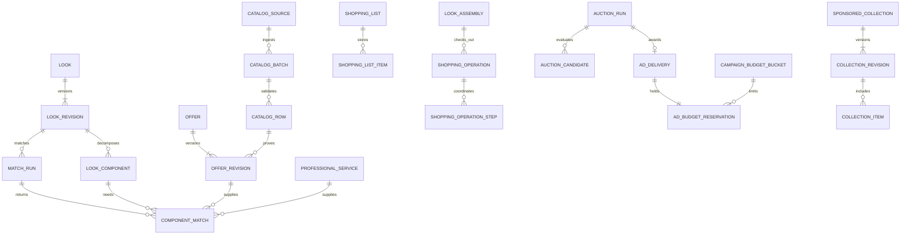

# Complete the Look — schema and API contracts

V2 schema/API deltas are in [global policy architecture](global-policy-architecture.md#logical-schema-delta) and the [companion extension](style-companion-extension.md#logical-schema-api-and-events-delta). They add age/guardian/market capabilities, visual search/evidence, professional feasibility, sharing/memory/wardrobe/twin/occasion/group/proposal and later B2B records under this same migration/ownership/financial history. Contracts remain proposals; generated OpenAPI describes implemented endpoints only. [Commerce operations](commerce-operations-v2.md) separates initial referral/request status from later order/booking/settlement authority.

Status: logical schema and reviewable wire-contract proposal, not executable migrations or implemented endpoints. Reuses the [canonical data model](data-model.md); all future changes enter its single Alembic history. IDs are UUIDs, timestamps UTC/RFC3339, money `{amount_minor: integer, currency: ISO4217}` and quantity decimal strings plus units. Country codes use ISO3166-1 alpha-2, timezone IANA, language BCP47. No raw image bytes, embeddings or secrets in public contracts.

## Schema delta

New rows use `id`, `created_at`, immutable historical revisions and audited mutable states. FKs below refer to existing canonical entities or new entities in this section. Organization-owned rows carry a tenant key with composite tenant/resource FKs; customer-private rows carry owner_user_id. Sensitive compatibility attributes are encrypted/purpose-restricted, not copied to ad events.

| Entity | Key fields, references and constraints |
|---|---|
| look | owner→user, source_type, source_asset→media_asset?, originating_job→ai_job?, source_post→creator_post?, current_revision→look_revision?, state; at least one authorized source, private by default |
| look_revision | look→look, revision_no, consent→consent_event, model→model_version?, taxonomy_version, content_hash, state, confirmed_at?, retention_until; unique look/revision_no, immutable content |
| look_component | revision→look_revision, component_key, category→catalog_category?, style→style_taxonomy?, role product/service/tool/accessory, required, quantity_min/max, unit, encrypted_constraints, confidence, provenance, confirmation_state; unique revision/key, min≤max, confidence 0–1 |
| component_dependency | revision→look_revision, component→look_component, requires→look_component, relationship prerequisite/substitute/incompatible, group_key?; same revision, no prerequisite cycles, no self-edge |
| catalog_source | merchant→merchant_account, kind API/CSV/manual, approved_fetch_host?, secret_ref?, freshness_policy_version, source_priority, state; never embed credentials |
| catalog_batch | source→catalog_source, idempotency_key, content_hash, source_sequence, completeness full/delta, state, validated/published_at?, counts, report_ref; unique source/key, old sequences cannot overwrite current |
| catalog_row | batch→catalog_batch, external_sku, operation upsert/delete, row_hash, validation_state, errors, evidence_ref; unique batch/external_sku, staged not automatically public |
| offer | merchant→merchant_account, variant→product_variant, market_country, native_currency, external_offer_id, current_revision→offer_revision?, state; unique merchant/external_offer/market/currency |
| offer_revision | offer→offer, version, source_row→catalog_row, price→product_price, stock_state known_available/known_unavailable/unknown, reported_quantity?, unit_pack_attributes, price_as_of, stock_as_of, price/stock_expires_at, evidence_hash; immutable, same seller/variant/currency |
| offer_delivery_rule | offer_revision→offer_revision, destination_country/zone, pickup_location?, state eligible/ineligible/unknown, evidence_source, estimate_min/max?, quote_required, as_of/expires_at; a range requires source evidence |
| professional_capability | profile→professional_profile, service→professional_service, style→style_taxonomy?, material/technique_codes, verification_state/source, verified_at/expires_at; merchant self-claims distinct from verified evidence |
| match_run | owner→user, revision→look_revision, market/currency, destination_ref?, requested_dates?, organic_policy_version, catalog_watermark, state, expires_at; no ad policy in organic inputs |
| component_match | run→match_run, component→look_component, offer_revision→offer_revision?, service→professional_service?, availability_evidence_ref?, rank, score_breakdown, confidence, match_kind exact/compatible/needs_confirmation, explanation_codes; exactly one offer/service, same look revision |
| match_coverage | match→component_match, component→look_component, supplied_quantity, unit, evidence; kits cover multiple requirements with explicit unit conversion |
| shopping_list | owner→user, name, look_revision→look_revision?, state, version; private until explicit sharing |
| shopping_list_item | list→shopping_list, component→look_component?, match→component_match?, selected_offer→offer?, selected_service→professional_service?, quantity, status selected/owned/unmatched/removed, last_verified_at; one selected target or explicit unmatched/owned |
| shopping_share | list→shopping_list, grantee→user?, token_hash?, permission read, expires_at, revoked_at?; no implicit access to source face image |
| look_assembly | owner→user, revision→look_revision, list→shopping_list, coverage_snapshot, policy_version, state; no invented global total when currencies/costs differ |
| shopping_operation | owner→user, assembly→look_assembly?, idempotency_key, request_hash, state, saga_version; unique owner/key; states pending/partially_confirmed/confirmed/compensating/failed |
| shopping_operation_step | operation→shopping_operation, seller→organization, quote→checkout_quote?, order→order?, booking→booking?, external_handoff_ref?, action_key, state, compensation_state, failure_code; unique operation/action_key |
| sponsored_collection | sponsor→advertiser_account, creator→creator_profile?, title, current_revision→collection_revision?, state |
| collection_revision | collection→sponsored_collection, version, disclosure_text, public_rights_record, contract→sponsorship_contract?, approved_at?; immutable, unique collection/version |
| collection_item | revision→collection_revision, offer→offer?, service→professional_service?, affiliate_link→affiliate_link?, position; exactly one target |
| sponsorship_contract | advertiser→advertiser_account, publisher→organization, currency, fixed_fee_minor, start/end, performance_definition, cancellation/proration_version, state; flat-fee obligation, not CPC spend |
| sponsorship_obligation | contract→sponsorship_contract, period, recognized_minor, journal→money_journal?, state; unique contract/period, revenue recognition only against earned obligations |
| auction_policy | version unique, placement→placement, relevance_floor, currency, minimum_cpc, cap/TTL/pacing rules, approved_by→user, effective_at; immutable |
| auction_run | request_key/slot unique, placement→placement, policy→auction_policy, coarse_context_code, catalog_watermark, audit_hash, state; no source image/traits/private text |
| auction_candidate | auction→auction_run, ad→ad, offer_revision→offer_revision?, service→professional_service?, campaign_revision_hash, public_relevance, bid_minor, result/reason; unique auction/ad, no private exclusion reasons |
| campaign_budget_bucket | campaign→campaign, local_date, timezone, cap_minor, held_minor, spent_minor, version; unique campaign/local_date, nonnegative, held+spent≤approved cap |
| advertiser_budget_allocation | advertiser→advertiser_account, currency, funded_or_approved_credit_minor, held_minor, charged_minor, version; unique advertiser/currency; links to ledger balances, not independent money source |
| frequency_counter | pseudonymous_scope_key, campaign/advertiser_scope, window_start, window_kind, counted, held, expires_at; unique key/scope/window, transactional hold limit |
| frequency_hold | delivery→ad_delivery, counter→frequency_counter, state, expires_at; unique delivery/counter; reserve/convert/release once for each campaign and advertiser cap |
| commercial_policy_version | kind attribution/commission/fraud/quote, version, rules_hash, approved_at; unique kind/version |

Extend existing `recommendation_set` with nullable `match_run_id` and existing `recommendation_item` with nullable `component_match_id`; look recommendations reference those canonical records rather than duplicate a second recommendation authority. Extend `ad_delivery` with `auction_run_id`, accepted bid/policy snapshot and nullable eligible offer revision, and `ad_budget_reservation` with budget bucket/allocation, validation deadline and financial state. Extend `ad_event` with event/received time and validation policy. Extend attribution/conversion/commission records with component/collection references only where nonsensitive and necessary; owner-private look revisions never enter advertiser reporting views. Order line snapshots preserve chosen offer revision and fulfillment source; external handoffs do not become platform orders.

Financial constraints use the existing balanced journals. `ad_charge` unique event lineage plus unique delivery/CPC-charge guards against duplicate billing. Reservations need atomic state transitions, enforced row locks/serializable retries and funds/cap checks across campaign/account/day. Apply sparse unique indexes and clear state machines to pending records; cached counters reconcile to durable holds/events. Access to auction audit rows is restricted, not an advertiser API. Persist versioned policy decisions for dispute replay without retaining private images beyond their retention purpose.



Cardinality describes published/active resources; empty drafts are valid. APIs returning `needs_confirmation`, no matches or no ad are valid outcomes, not errors to hide with invented data. Retention/deletion policies extend to private components, constraints, lists and matching evidence; published collection rights/financial minimums have separately justified retention.

## API conventions

Prefix `/v1`; authenticated OIDC user/session except signed webhooks and documented read-only public collections. Every operation enforces owner/tenant/scopes server-side; unowned private IDs return indistinguishable 404. Async calls return `202` with operation/job ID and status URL; poll or authenticated SSE. No public job payload includes source media access grants. Lists use cursor pagination, limits, filter allowlists and explicit policy/data `as_of` versions.

Commercial/job creation and ingestion require `Idempotency-Key`, scoped to principal+route, stored with request hash: same request replays, changed payload returns 409. Propose 7-day API response-key retention, while permanent business event/ledger uniqueness survives that expiry. Mutable resources use ETag/`If-Match`; stale edits return 412. Date/amount/quantity/schema violations return 422, unavailable/changed offers 409, expired quotes/delivery tokens 410, rate/quota limits 429 with Retry-After. Errors have `{code, message, request_id, retryable, field_errors?}` and no secrets or private existence hints. A safe retry does not imply a new charge.

| Route | Request essentials | Response / authorization |
|---|---|---|
| `POST /looks` | source `{asset_id|ai_job_id|published_post_id}`, processing consent ref | 201 private look; verify source access and purpose |
| `POST /looks/{id}/decompositions` | input revision, confirmed preferences, optional accepted AI quote ID | 202 AI job/status; quoted charge only if approved pricing requires it; existing consent/credit/job machinery reused |
| `GET /looks/{id}/revisions/{n}` | — | Components/dependencies/confidence/provenance for owner; no merchant assertions manufactured |
| `POST /looks/{id}/revisions` | base revision, user component edits/confirmations, If-Match | 201 new immutable revision, out-of-date edit 412 |
| `POST /match-runs` | look revision, market, currency, shipping address ref or coarse zone, desired service date/radius | 202 or 201 cached-equivalent run; requires confirmed essential constraints |
| `GET /match-runs/{id}` | optional cursor/component filters | Owner organic matches, separate sponsored state/endpoint, unmatched reasons, evidence timestamps and expiries |
| `POST /match-runs/{id}/sponsored-slots` | placement, slot/page nonce, allowed ad consent context | 200 labeled slots + opaque signed delivery token or empty list; server derives safe context; unique request/slot prevents double holds |
| `POST /ad-events` | signed delivery token, event type, event nonce, timing/interaction evidence | 202 receipt; no client-supplied bid/spend; signed lineage still fraud-validated |
| `POST /shopping-lists` | name, optional revision | 201 owner-private list |
| `PATCH /shopping-lists/{id}` | selected/owned/unmatched entries, If-Match | Updated list, no price/availability guarantee; user quantities validated |
| `POST /shopping-lists/{id}/shares` | expiry, grantee/read scope | Grant omits source image; revoke through DELETE grant |
| `POST /look-assemblies` | revision/list, owned items, substitutions | Coverage/conflicts, totals grouped by native currency, unknown cost fields, revalidation required |
| `POST /shopping-quotes` | assembly, delivery address, service slot choices | 202 operation; child expiring quotes with tax/shipping/deposit evidence and external handoffs |
| `POST /shopping-operations` | accepted child quote IDs and policy versions, payment tokens where needed, user confirmation | 202 saga status, never trusts client totals; price changes need fresh confirmation |
| `GET /shopping-operations/{id}` | — | Child orders/bookings/hold expiry/compensation/refund status for owner |
| `GET /professional-services/{id}/availability` | date range, timezone | Actual slot evidence/expiry; existing booking API must acquire final hold |
| `POST /merchant/catalog-sources` | API/CSV/manual config, credential reference only | Merchant catalog-manager scope; approved domains and review state |
| `POST /merchant/catalog-batches` | source, schema/version/sequence, full/delta, upload object or API rows, hash | 202 validation report; uploads use existing quarantine controls |
| `POST /merchant/catalog-batches/{id}/publish` | validated batch hash, approval ref | Idempotent publication/projection status, rejects stale sequence or incomplete destructive full feed |
| `GET /merchant/catalog-batches/{id}` | cursor for errors | Tenant-limited counts, freshness and sanitized errors |
| `POST /advertiser/campaigns` | linked offers/services, contexts, country/currency, max CPC, caps, schedule/timezone, frequency settings, creative refs | Draft/review status; advertiser campaign-manager scope; cannot submit sensitive targets |
| `PATCH /advertiser/campaigns/{id}` | versioned edits or pause, If-Match | Approved revision or review-needed, disclosed in-flight exposure |
| `GET /advertiser/budgets` | account/campaign filters | Authorized finance scopes; held/pending/spent/available consistent with ledger |
| `GET /advertiser/reports` | allowed dimensions, period, timezone/currency | Aggregate/suppressed metrics, as_of, attribution/billing versions; no user/private look IDs |
| `POST /advertiser/report-exports` | same authorized filters | Async private expiring report with same privacy policy; no CSV formula execution |
| `POST /sponsored-collections` | rights, sponsor/creator, offer/service refs, contract, disclosure | Scoped publisher/advertiser approval workflow; public GET only approved revision |
| `POST /webhooks/affiliate/{network}` | signed payload/external event ID | Authenticated contracted network, verified receipt and inbox dedup; client cannot call as conversion proof |

Existing order/payment/refund/booking and funding endpoints remain canonical. Internal service contracts (not public internet APIs): `decompose`, `match_products`, `match_professionals`, `auction_and_reserve`, `validate_click`, `attribute_verified_conversion`, `post_ad_charge`, `orchestrate_checkout`. Each carries request/trace ID and schema version; business handlers reauthorize referenced resources, not just trust a queue message. Result events contain stable IDs and redacted metadata, never raw private media.

### Illustrative match response shape

This is a schema illustration using symbolic IDs, not a real offer or inventory statement:

```json
{
  "match_run_id": "<uuid>",
  "look_revision_id": "<uuid>",
  "market": "ZA",
  "organic_policy_version": "<version>",
  "components": [{
    "component_id": "<uuid>",
    "state": "unmatched",
    "required": true,
    "quantity": {"min": "4", "max": "6", "unit": "pack", "requires_confirmation": true},
    "organic_matches": [],
    "unmatched_reason": "NO_VERIFIED_LOCAL_OFFER"
  }],
  "sponsored_slots": [],
  "totals": [],
  "unknown_cost_components": ["<uuid>"],
  "as_of": "<RFC3339 timestamp>"
}
```

When matched, each offer includes catalog ID/revision, merchant ID, match kind/explanation, native amount/currency/tax basis, stock status/source/as_of/expires_at, delivery eligibility/evidence, public product media and checkout mode. Optional display FX has its own rate/time/expiry and `estimate: true`. Services include price basis (`fixed/from/consultation_required`), capability verification and availability evidence; only fixed accepted quotes enable authoritative totals. Unknown costs are nullable, never zero by default. Sponsored entries additionally require advertiser identity, literal disclosure, placement ID and opaque signed event token; no facial fields are permitted by schema.
