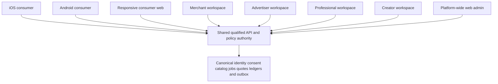
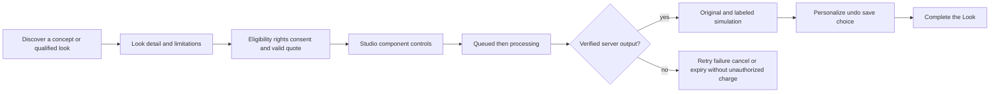

# GLAM AI UI/UX design review and development handoff

**Current authority:** [Analysis-first build](analysis-first-build.md). The latest user instruction authorizes implementation now, then external connections. Face Analysis, Color Analysis, Glow-Up Guide and makeover lead the experience; Home · Analyze · AI Studio · AI Advisor · Profile replaces the earlier shopping-first navigation. One Expo app, consumer web, unified business portal and restricted admin share canonical identity/RBAC/backend/migrations. Older design-approval waiting and surface/navigation descriptions below are historical where they conflict; production activation/release gates remain.

5 November 2026 · Design specification v1.0 · **Primary flows/design system proposed for review; no production implementation authorized by this package.**

Source: the [complete UI/UX brief](sources/2026-11-ui-ux-design-brief.txt) and the accompanying visual references. The references inform editorial scale, photography, restrained cards, immersive previews and task hierarchy; their brand layouts, product images, logos, claimed prices/reviews and business metrics are not reproduced. New photographic assets are original AI-generated editorial/product illustrations, clearly separated from actual user results or merchant inventory.

## What changes from the earlier plan

The newest explicit brief expands **design scope** to eight connected applications: iOS consumer, Android consumer, responsive consumer web, merchant web, advertiser web, professional web, creator web and administrative web. It supersedes the earlier landing-only website/mobile-only non-admin design restriction. `/admin` still manages the entire platform, including mobile. This does not change the running application or authorize new production portals before review.

Mobile primary navigation is now **Home · Discover · Studio · Shop · Profile**. AI Advisor is contextual, not a permanent sixth tab. Analysis/capture lives inside Studio; conversation history/assistant entry no longer occupy a primary tab. Consumer desktop navigation is **Discover · AI Studio · Hair & Beauty · Fashion · Shop the Look · Professionals · Creators**, with search, region/currency, saved looks, account and shopping plan controls.

Google/Supabase, canonical migrations, server-authoritative commercial operations, global age/guardian safeguards, private media and prior financial/security invariants remain. The UI brief's signup/recovery labels use the selected identity provider, not an unreviewed second password system. The latest palette replaces the earlier rose/plum proposal: Ink `#17151A`, Ivory `#F8F4F0`, Rose `#D96B95`, Lilac `#A98ABD`, Gold `#C9A46A`.

## Deliverable register — exact completion boundaries

| Requested deliverable | Artifact / status |
|---|---|
| 1. Information architecture for every application | [Machine-readable IA](../design-preview/information-architecture.json), eight application definitions, five separate role-workspace layouts, route proposal below |
| 2. Complete screen inventory | [Screen catalog](../design-preview/screen-catalog.json): 71 retained consumer families, eight web families and 54 role-workspace families. These have dedicated HTML frame studies and editable SVG wireframe studies, not 133 implemented native/Figma screens; each has capability/journey/acceptance and coverage status |
| 3. Journey maps | J00–J07 below, including capture gates, comparison/handoff, occasion/assistant, professional quote and campaign review |
| 4. Low-fidelity wireframes | Wireframe toggle for all prototype surfaces; [mobile starter SVG](../design-preview/figma-ready/wireframe-mobile-home.svg), [desktop Complete starter SVG](../design-preview/figma-ready/wireframe-desktop-complete-look.svg) and captured primary studies. All 133 family studies have a wireframe mode plus editable SVG task wireframes in `figma-ready/screen-families` |
| 5. High-fidelity Figma designs | High-fidelity **HTML/CSS primary-flow prototype** and original imagery are provided. **Native Figma file, native component variants/auto-layout are outstanding: no Figma authoring tool is connected. The HTML library has 133 dedicated task studies; these are not a complete native Figma library.** Do not label this package a completed `.fig` file |
| 6. Responsive variants | Phone 320/390/430, tablet 768, desktop 1440/1920 layout checks; independent desktop/tablet comparison/Studio compositions, not scaled phone canvases. Native device rendering remains unverified |
| 7. Reusable components/tokens | [Typed tokens](../design-preview/tokens.json), [20 component contracts](../design-preview/components.json), CSS and [editable component SVG starter](../design-preview/figma-ready/components.svg). Native Figma library authoring/import verification remains outstanding |
| 8. Critical interactive prototypes | [Review prototype](../design-preview/index.html): Discover → look → Studio → Complete → compare → unverified handoff; product → plan; occasion wizard; professional request; guided advertiser creation; private preference reset. No real job/transaction is simulated as completed |
| 9. Empty/loading/error/offline/denied/success | Toolbar state inspector on supported surfaces, typed explanation and reset. Success explicitly remains a layout preview pending authoritative server confirmation |
| 10. Accessibility audit checklist | Checklist and measured contrast below; keyboard/dialog/focus/reduced-motion/responsive checks passed. Full WCAG/assistive-technology/native/translated-text audit remains outstanding |
| 11. Design-to-code specification | Token/component contracts, route/capability/state/permission rules below and catalog; unchanged application code and shared existing backend authorities |
| 12. Screen-by-screen acceptance | Every catalog entry includes its gate, journey, backend domain, prototype coverage, state/accessibility and honest-commerce assertions; actual service acceptance tests remain future implementation work |

This register intentionally distinguishes completed independent work from external/native-authoring and validation still needed. Attractive primary prototypes do not satisfy every release or implementation gate.

## Information architecture and route proposal

| Surface | Logical routes / navigation | Presentation and authority |
|---|---|---|
| iOS/Android | Home, Discover, Studio, Shop, Profile; nested look, analysis, Complete, compare, occasion, account and contextual Advisor | Safe-area/native target conventions, image-led Studio, persistent five-tab structure, confirmation/state-aware nested flows. Same owner/policy/quote authorities |
| Consumer web/tablet | `/`, `/discover`, `/studio`, `/looks/:id`, `/shop-the-look/:id`, `/shop`, `/professionals`, `/creators`, `/account` | Editorial browsing, three-column desktop editing/comparison, two-column tablet, saved/session continuity without private data leakage |
| Merchant | `/merchant/*`: Overview, Catalog, Inventory, Orders/Leads, Promotions, Advertising, Analytics, Payouts, Storefront, Settings, Support | Verified organization team/role; reviewed drafts, source facts and reconciliation |
| Advertiser | `/advertiser/*`: 11 source modules including campaign wizard, disclosure/placement preview, budgets/bids, attribution/reporting/billing/brand safety | Verified advertiser/campaign and financial authority; permitted nonsensitive context only |
| Professional | `/professional/*`: Dashboard, Services, Portfolio, Calendar, Quotes, Clients, Promotions, Reviews, Earnings, Settings | Scoped qualified professional; explicit reference sharing, feasibility/materials/full price and real slots |
| Creator | `/creator/*`: Published Looks, Collections, Affiliate Links, Attributed Sales, Commissions, Invitations, Payouts | Rights/moderation/publication/verified-event controls; private consumer media remains separate |
| Admin | `/admin/*`: 15 named functional groups from the latest brief | All platform surfaces; role-scoped operational controls and backend MFA/audit. Sidebar layout is not authorization |

These are logical application boundaries, not a request to create eight disconnected services, databases or Git checkouts. Consumer and role-specific Next.js layouts can initially share the existing repository/framework with explicit route/session guards and isolated data contracts. Whether later deployments become separate apps requires an architecture decision. No route is created in the production app by this design package.

Cross-device continuation means the same authenticated principal retrieves authorized state from the backend. Do not copy browser cookies, raw access tokens, private photos or signed URLs into mobile deep links. Any optional transfer code must be short-lived, single-use, scoped to the intended state and redeemed after identity/authorization/CSRF-state checks; a device handoff never confirms a changed quote or purchase automatically.

## User journey maps and capability gates

### J00 — onboarding / optional Style DNA

Welcome/value → region/language → risk-appropriate age/guardian entry → selected Google/Supabase identity → optional explicit style preferences → purpose/retention information → optional photo setup only when qualified. Basic exploration precedes a paywall. Marketing, memory learning, media processing and public sharing remain independent choices. Unknown/unqualified age or market can see appropriate generic information, not private processing or financial authority.

### J01 — Discover → Try → Personalize → Complete

The prototype uses an unchanged illustrative portrait on both sides of the comparison control and a state inspector, not actual generation. No real result becomes ready merely because an animation finishes. Camera permission follows purpose/eligibility and an explicit action; denied permission has a safe manual alternative. Collapsible controls must leave original/undo/price/state/cancel information reachable.

### J02 — Complete → compare → Shop / partner handoff

Selected look → hairstyle/makeup/clothing/shoes/accessories/services breakdown → Best Match / Lowest Total Cost / Fastest Available views → independent organic/Sponsored sections → item/source/variant/price/stock/delivery/returns evidence → full delivered-cost comparison → explicit accepted obligations → approved seller handoff or later qualified checkout. Unknown costs prevent a firm total/budget/fastest claim. A click or return-to-app is not proof of purchase.

In the prototype all commercial facts remain unavailable/unverified/unknown. Handoff is reviewable but external purchase is disabled. This demonstrates the failure/uncertainty path honestly instead of inserting invented stock, prices, reviews or delivery claims.

### J03 — contextual Advisor / Occasion Concierge

Contextual Ask GLAM → user-selected goal/occasion/date/location/budget/preferences → constrained server planning/retrieval and deterministic full-cost calculation → three qualified directions if evidence exists → customize one → preparation checklist with source-backed arrival/service deadlines → optional reminders and explicit transaction confirmation. The design shows illustrative directions and uncertainty; it does not claim actual qualified proposals or execute agent tools.

Style DNA allows inspection/correction/reset and separates explicit choices from permitted learning. Initial youth modes use qualified curated guidance; no unrestricted chat, sensitive identity inference, public child profile, personal-profile ads or photorealistic child twin.

### J04 — Book the Exact Look

Customer selects references/rights → eligible professional → scoped, revocable style-board sharing → feasibility/materials/duration/full-price quote → quote-version acceptance → real availability and payment obligations if supported → confirmed booking. A request, feasibility quote or preview summary is not a confirmed slot. Professional references never imply unrestricted selfie access.

### J05 — profile, billing, privacy and accessibility

Owned account → optional memory/preferences, private saves/wardrobe/twin, plans/credits/restore, notifications, accessibility/locale, consent/export/delete. Server verification governs entitlements and all credit effects. Separate consent controls and derivative/vendor deletion evidence are required. Real native/identity/billing/rights-request flows are not implemented in this prototype.

### J06 — advertiser review before launch

Objective → Eligible products → Placement → Budget → Creative → Review → Launch. Validate source inventory/rights, currency and hard caps, qualified context/age/market, disclosure, landing destination, fraud/attribution and billing. Customer placement preview must match what is delivered. In the prototype each step is navigable and Launch remains unavailable; no real advertiser, funded budget or campaign exists.

### J07 — merchant / professional / creator / admin operations

Qualified identity/organization/role → separate workspace → actual source/case/event evidence → scoped draft or operational action → reason/confirmation/approval where required → authoritative side effect → audit and reconciliation. Prototype module navigation/empty-state composition is not a complete functional module. No fabricated revenue, zero counts, activity histories, partner contracts or verification badges appear.

## Screen library and grouping crosswalk

The existing M01–M71 requirements remain stable. Analysis screens M07–M19 move under Studio, discovery/search/occasion families under Discover/Home, shopping/Complete families under Shop, and Advisor/routines remain contextual. The catalog adds W01–W08 responsive web families and MER01–11, ADV01–11, PRO01–10, CRE01–07, ADM01–15 workspace families. Each has dedicated HTML task controls, an editable SVG wireframe and acceptance notes. The linked primary journeys provide interaction studies; native Figma screens and detailed subflows within combined families remain outstanding.

The newest brief lists 15 named admin functional groups. Earlier A01–A16 are retained as requirement/authority IDs, not a promise of 16 current navigation items. Crosswalk: Executive→A01; Users→A02; AI Ops→A05/A06; Beauty Content/Creators→A10; Merchant→A07/A08; Professional→A09; Advertising→A11; Commerce/Subscriptions→A03/A04 plus canonical order/finance domains; Regional/System Configuration→A12/A15/A16; Trust/Privacy→A02/A13/A14; Analytics→permitted A01/A16/report projections. Grouping never merges backend permissions or grants access.

Seven admin layout roles are represented: Super Admin, Finance, Customer Support, Content Editor, AI Operations, Compliance and Read-Only Analyst. Support layout omits financial navigation/metrics. No role selector authenticates a user; real access requires exact-project identity, required assurance/MFA, server authorization and scoped audit. Financial/private-data actions retain reason/dual-approval rules.

## Design-to-code component and state contract

- Use the [typed token file](../design-preview/tokens.json), shared logical spacing, responsive grids and semantic names. Map native equivalents carefully: HTML px studies are not proof of iOS pt/Android dp or safe-area behavior. Maintain at least 44 px interactive targets in this study and qualified native minimums before release.
- Editorial serif is for campaign/display hierarchy; functional sans-serif labels/forms/amounts remain highly legible. International scripts need qualified fonts and fallback behavior; do not force Latin display fonts onto unreadable scripts.
- Original photos/product still lifes are unbranded design illustrations, not benchmark output or catalog assets. Keep intrinsic composition/complexion/proportions; do not show fake before/after changes. Replacing them with real assets requires rights/privacy/source evidence.
- Lifecycle components cover loading, empty, error, offline, permission-denied and authoritative success. Error retries preserve the accepted obligation/idempotency lineage; offline cannot silently submit or reprice. Real service status and server output determine completion.
- Cards show commercial evidence/source/freshness and uncertainty. “Sponsored” is visually and semantically separate from organic results; no identity/protected/private-data targeting. Unknown/teen/child sample layouts suppress risky processing/commerce and do not grant guardian or adult authority.
- Dialogs have names, focus containment, Escape close and focus restoration. Buttons/inputs have labels; important state is not communicated by color alone. No password, ID, payment or photo input is collected by the prototype.
- The design server allows static GET/HEAD only and has `connect-src 'none'`; all previews are isolated from live APIs. This is a prototype boundary, not a production security architecture.

## Responsive and accessibility review

| Layout | Defined approach / current evidence |
|---|---|
| 320–390 phone | Single column, five destinations, scrollable categories/content, persistent Advisor entry and safe action bars; header adaptation prevents clipping |
| 414–430 phone | Image-led canvas, native-sized framing and large touch controls; iOS/Android variants are concepts, not native binaries |
| 768 tablet | Two-column look comparison with summary below; Studio split view; no stretched phone frame |
| 1440–1920 desktop | Three-column Studio and Complete workspace, separate role navigation, visible summaries and comparison tables |
| RTL | Logical spacing and partial Arabic mobile navigation study, media not mirrored; professional translation, mixed-script amounts and full assistive-technology audit outstanding |
| Reduced motion / bandwidth | No essential motion; reduced-motion CSS enforced. Two local shared WebP sheets total about 285 KiB versus roughly 4.4 MiB original PNG sheets; source originals retained outside checkout, no external font/image/API requests |

Computed WCAG sRGB contrast: Ink/Ivory **16.56:1**, muted/Ivory **5.33:1**, Ink/Rose **5.60:1**, Ink/Lilac **6.09:1**, Ink/Gold **7.77:1**, white/dark Action Rose **7.65:1**. White/Rose is **3.24:1**, so raw Rose is not a normal-text white-label button. Decorative borders/Gold are not small body text. Image-overlay text requires actual rendered review; token arithmetic is not full WCAG certification.

Audit checklist before approving production designs: all responsive states and text scaling; contrast of controls/focus/imagery overlays; keyboard and reading order; dialog/error announcements; VoiceOver/TalkBack; native target/safe-area behavior; forced-colors/reduced-motion; international fonts and complete RTL translations; low-bandwidth retry/progressive loading; age/guardian denial and rights routes; exact/Similar/Unknown disclosures; actual quote, cancellation and error semantics. Automated checks cover only the bounded prototype behaviors recorded in [test results](../design-preview/test-results.json).

## Figma and remaining work

Use [handoff manifest](../design-preview/figma-ready/handoff-manifest.json), tokens, component contracts, screen catalog, original illustrations, 25 captured primary PNG frames, 133 family JPEG studies, five editable SVG starter studies and 133 editable task wireframes. SVGs contain editable text/shapes plus embedded raster image fills; they are not a native Figma component/variable/auto-layout library. Import/typography fidelity has not been tested in Figma. No native `.fig` file was created because no Figma authoring capability is available in this session.

Remaining design work: native Figma file, component/auto-layout authoring and import verification; detailed subflows within combined screen families; translated/RTL, assistive-technology and native-device validation; usability testing with representative consenting eligible participants. Remaining product work: actual identity/age/guardian/API/provider/catalog/commerce/admin implementation under approved architecture. Primary flow review does not imply those services work.

The user's brief says **“Do not begin implementation until the primary flows and design system are approved.”** This design package is the concrete review artifact. Review the primary flows, token/component direction, changed web scope and acceptance/coverage limitations before authorizing application implementation; the earlier global architecture/release gates remain in force.
